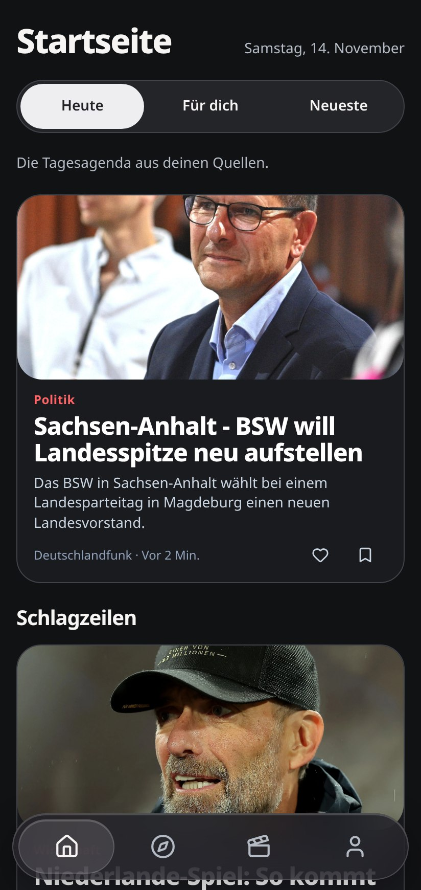
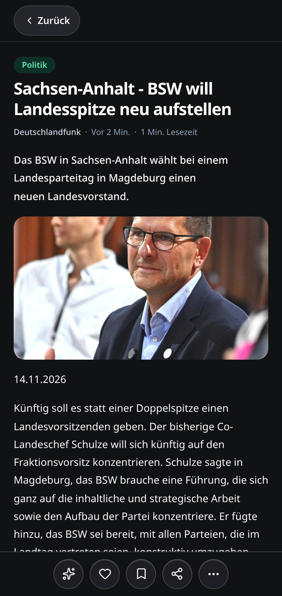
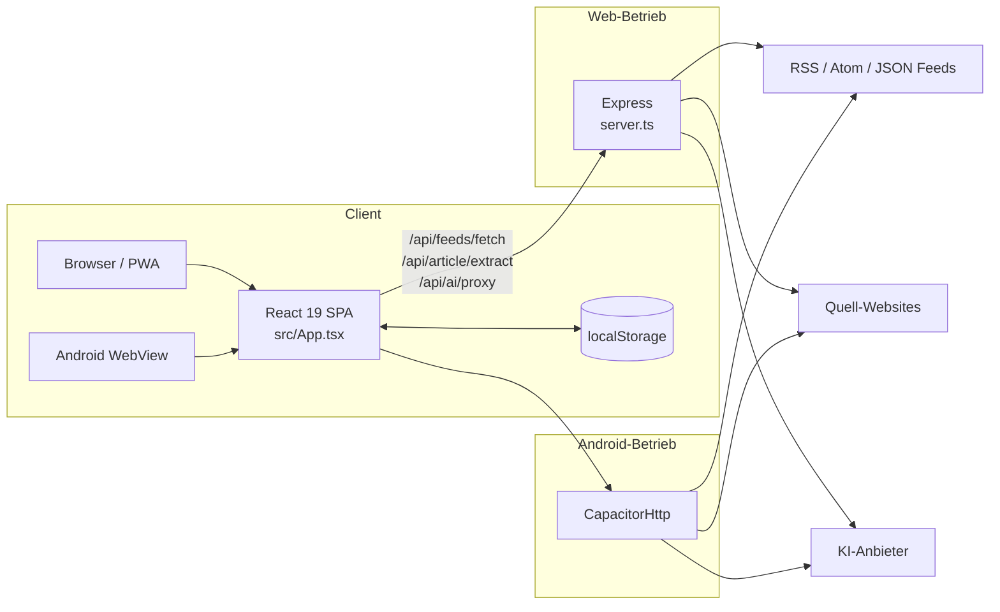

<div align="center">


# OpenNews

**Deine Nachrichten. Deine Quellen. Dein Gerät.**

Datenschutzfreundliche, Apple-inspirierte Nachrichten-App für freie RSS-, Atom- und JSON-Feeds — lokal personalisiert, optional mit eigener KI.

<br />


<br />

[Funktionen](#funktionen) · [Screenshots](#screenshots) · [Architektur](#architektur) · [Projektstruktur](#projektstruktur) · [Erste Schritte](#erste-schritte) · [Konfiguration](#konfiguration) · [Server-API](#server-api) · [Android](#android) · [Mitwirken](#mitwirken)

</div>

---

> [!NOTE]
> **Alpha:** OpenNews steht bei `0.1.0-alpha.1`. Web und PWA sind nutzbar, Android ist ein privater Debug-Build. Artikelvolltext und BYOK-KI sind Beta. Es gibt noch kein Play-Store-Release, keine hinterlegte Open-Source-Lizenz.

## Was ist OpenNews?

OpenNews bündelt Nachrichten aus frei zugänglichen Feeds in einer ruhigen Oberfläche. Statt eines undurchsichtigen Feed-Algorithmus entscheidest du selbst über deine Quellen — und die App lernt ausschließlich auf deinem Gerät, was dir gefällt.

- **Kein Konto, keine Cloud-Pflicht.** Abos, Likes, Lesezeichen und Einstellungen liegen im lokalen Speicher.
- **Freie Quellen.** RSS 2.0, RSS 1.0/RDF, Atom 1.0 und JSON Feed 1.0/1.1.
- **Nachvollziehbare Empfehlungen.** Sichtbare Gewichte für Thema, Quelle, Schlagwörter und Aktualität.
- **KI nur auf Wunsch.** Lokale Zusammenfassung ist immer da; ein eigenes Sprachmodell ist optional (BYOK).
- **Eine Codebasis.** React im Browser, dieselbe Oberfläche als PWA und als Capacitor-App auf Android.

## Funktionen

| Bereich | Umfang |
| --- | --- |
| **Quellen** | 34 vorkonfigurierte Feeds (Tagesschau, ZDFheute, Deutschlandfunk, FAZ, SPIEGEL, ZEIT, SZ, Handelsblatt, WELT, BILD, heise, Golem, t3n, Guardian, BBC, Hacker News, Ars Technica, NASA u. a.) plus beliebig viele eigene Feeds |
| **Feed-Formate** | RSS 2.0, RDF, Atom 1.0, JSON Feed, Podcast-Feeds; Domain-Erkennung über `link rel="alternate"`; OPML-Import/-Export |
| **Startseite** | **Heute** (ab Mitternacht), **Für dich** (48 h, personalisiert), **Neueste** (streng chronologisch); Pull-to-Refresh, ähnliche Titel weiter unten |
| **Personalisierung** | Like, Dislike, Lesezeichen, Lesezeit und Verlauf formen lokale Gewichte; Vielfalt mischt Quellen und Themen |
| **Reader** | Volltext-Extraktion mit Feed-Fallback, Zusammenfassung, drei Schriftgrößen, Serif/Sans, Vorlesen, Teilen |
| **Video & Audio** | Große Vorschauen für Videos und Audio, Hochformat-Clips zum Wischen, Likes, Merkliste und Teilen. YouTube über den offiziellen Player. |
| **Entdecken** | Themenraster, Quellen- und Volltextsuche, letzte sechs Suchbegriffe lokal gespeichert |
| **Darstellung** | System/Hell/Dunkel, Akzentfarbe, Transparenz, Ecken, Kartendichte, Textgröße, reduzierte Bewegung |
| **PWA** | Installierbar, Service Worker mit Auto-Update, Offline-Hinweis, maskierbares Icon |
| **Android** | Capacitor-WebView, direkte HTTP-Aufrufe, nativer Zurück-Knopf und Share-Dialog |
| **Benachrichtigungen** | Android-Push für unterstützte abonnierte Quellen mit eingerichtetem Firebase. Im Web erscheinen Hinweise in der geöffneten App. |

**Aufbewahrung:** 2, 4, 7, 14, 30 oder 90 Tage (Standard **4**), maximal **600** Beiträge im Speicher. Beim Aktualisieren werden neue Artikel zusammengeführt; Abos, Lesezeichen, Likes und Verlauf bleiben erhalten.

## Screenshots

> [!NOTE]
> Design-Referenzen aus der Konzeptphase. Die reale App nutzt echte Quellen und kann je nach Feed und Gerät abweichen.

| Startseite | Entdecken | Artikel-Reader |
| :---: | :---: | :---: |
|  |  |  |

## Architektur

React-SPA, schlanker Express-Server für den Web-Betrieb und eine Capacitor-Hülle für Android. Die Fachlogik liegt in `src/lib/` und ist frameworkunabhängig testbar.



| Modus | Start | Netzwerkpfad |
| --- | --- | --- |
| Entwicklung | `npm run dev` | Browser → Vite-Middleware → Express-Routen (Port `3000`) |
| Web-Produktion | `npm run build` + `NODE_ENV=production npm start` | Browser → Express → Feeds/Websites/KI |
| PWA | installierte Web-App | wie Produktion; Assets im Service-Worker-Cache |
| Android | Debug-APK | WebView → `CapacitorHttp` → Feeds/Websites/KI (kein Node-Server) |

**Datenfluss:** Feed-URL → HTTP-Abruf → `parseFeedPayload()` → Normalisierung (Titel, Datum, Kategorie, Schlagwörter, Medien, Lesezeit) → `mergeFeedArticles()` (Merge, Aufbewahrung, 600er-Limit) → `buildHomeSections()` → React-Oberfläche.

## Technologie-Stack

| Ebene | Technologie |
| --- | --- |
| UI | React 19, Motion 12, lucide-react |
| Sprache | TypeScript 7 |
| Build | Vite 8 |
| Styling | Tailwind CSS 4 |
| Feed-Parsing | fast-xml-parser 5 |
| Server | Express 4 |
| PWA | vite-plugin-pwa 2 |
| Android | Capacitor 8 |
| Tests | Node Test Runner mit tsx |
| CI | GitHub Actions (Typecheck, Tests, Build, Debug-APK) |

## Projektstruktur

Versionierte Ordner und Dateien. Bilddateien sind gruppiert; generierte Ordner stehen darunter.

```text
OpenNews/
├── .github/
│   └── workflows/
│       └── android-test-apk.yml        # CI: Typecheck, Tests, Web-Build, Debug-APK, Pre-Release
│
├── docs/
│   └── screenshots/                    # Design-Referenzen für diese README
│       ├── artikel.jpeg
│       ├── entdecken.jpeg
│       └── startseite.jpeg
│
├── native/
│   └── android/
│       ├── MainActivity.java           # Nativer Einstieg: Back-Navigation + ArticleShare
│       └── sync-icons.sh               # Erzeugt die Android-Launcher-Icons aus dem Logo
│
├── public/                             # Statisch ausgelieferte Dateien
│   ├── assets/aistudio/                # Design-Mockups und PDF aus der Konzeptphase
│   ├── apple-touch-icon.png
│   ├── icon.svg
│   ├── logo.png
│   ├── pwa-192x192.png
│   ├── pwa-512x512.png
│   └── pwa-maskable-512x512.png
│
├── src/
│   ├── assets/images/                  # Redaktionelle Bilder für Demo-Artikel
│   │   ├── news_ai_semiconductor_*.jpg
│   │   ├── news_bundestag_berlin_*.jpg
│   │   ├── news_eu_parliament_*.jpg
│   │   ├── news_exoplanet_space_*.jpg
│   │   └── news_renewable_europe_*.jpg
│   │
│   ├── components/                     # React-Komponenten
│   │   ├── ArticleCards.tsx            # Aufmacher- und Kompaktkarten
│   │   ├── ArticleImage.tsx            # Bild mit Quellen-Fallback
│   │   ├── ArticleMedia.tsx            # Medien im Reader
│   │   ├── ArticleReaderModal.tsx      # Reader-Sheet, Zusammenfassung, Teilen, Vorlesen
│   │   ├── DiscoverSearch.tsx          # Suche, Vorschläge, letzte Suchen
│   │   ├── DiscoverView.tsx            # Themen- und Quellenübersicht
│   │   ├── HomeView.tsx                # Heute / Für dich / Neueste, Pull-to-Refresh
│   │   ├── MediaPlayer.tsx             # Audio-, Video- und YouTube-Player
│   │   ├── MediaView.tsx               # Bereich Video & Audio
│   │   ├── Preferences.tsx             # Onboarding, Profil, Darstellung, Themen
│   │   ├── PWAInstallButton.tsx        # Installationshilfe und Offline-Hinweis
│   │   ├── SavedView.tsx               # Lesezeichen, Likes, Verlauf, Algorithmus-Reset
│   │   └── SettingsView.tsx            # Quellen, KI, Benachrichtigungen
│   │
│   ├── hooks/
│   │   ├── useLocalStorage.ts          # Typsicherer localStorage-Hook mit Fehlerbehandlung
│   │   └── usePWAInstall.ts            # Installierbarkeit und Online-Status
│   │
│   ├── lib/                            # Fachlogik, unabhängig von React
│   │   ├── aiClient.test.ts            # Tests für KI-Konfiguration und Antwortparsing
│   │   ├── aiClient.ts                 # BYOK-Anbieter, Prompt, Proxy/Fallback, Verbindungstest
│   │   ├── articleMedia.ts             # Abspielbare Medien eines Artikels
│   │   ├── catalog.ts                  # 34 Standardquellen und Legacy-URLs
│   │   ├── nativeFeed.test.ts          # Tests für native Feed-Sicherheit
│   │   ├── nativeFeed.ts               # CapacitorHttp, Feed-Erkennung, Volltext
│   │   ├── newsFeed.ts                 # Merge, Pruning, Heute/Für dich/Neueste
│   │   ├── opml.test.ts                # Tests für OPML
│   │   ├── opml.ts                     # OPML 2.0 lesen und schreiben
│   │   ├── personalization.test.ts     # Tests für Ranking, Vielfalt, Reaktionen
│   │   ├── personalization.ts          # Profil, Gewichte, Scoring, lokale Zusammenfassung
│   │   ├── preferences.ts              # Presets, Aufbewahrung, Startseiten, Defaults
│   │   ├── rssParser.test.ts           # Tests für RSS, Atom, JSON und Medien
│   │   ├── rssParser.ts                # Feed-Parser und Normalisierung
│   │   ├── scrollNavigation.test.ts    # Tests für das Ausblenden der Navigation
│   │   ├── scrollNavigation.ts         # Scroll-Richtung und Schwellwerte
│   │   └── seedArticles.ts             # Lokale Demo-Artikel mit Bildern
│   │
│   ├── types/news.ts                   # Artikel, Quellen, Profil, KI, Einstellungen
│   ├── App.tsx                         # App-Zustand, Navigation, Feed-Abruf, Theme
│   ├── index.css                       # Design-Tokens, Glas-Optik, Layout, Dark Mode
│   └── main.tsx                        # React-Root
│
├── .env.example                        # Platzhalter aus der AI-Studio-Vorlage (siehe Konfiguration)
├── .gitignore                          # Node, Build, Logs, .env
├── DESIGN.md                           # Gestaltungsleitlinien
├── PRODUCT.md                          # Produktbeschreibung
├── README.md                           # Diese Datei
├── bun.lock                            # Lockfile (Bun); die CI nutzt npm
├── capacitor.config.ts                 # App-ID, WebView, CapacitorHttp
├── index.html                          # HTML-Shell, Theme-Bootstrap, Meta-Tags
├── metadata.json                       # Metadaten der AI-Studio-Vorlage
├── package.json                        # Abhängigkeiten und Skripte
├── server.ts                           # Express-API und Vite-/Produktions-Server
├── tsconfig.json                       # TypeScript-Konfiguration
└── vite.config.ts                      # React, Tailwind, PWA, Alias, Dev-Server
```

### Generierte Ordner

| Ordner | Entstehung | Hinweis |
| --- | --- | --- |
| `node_modules/` | `npm install` | Abhängigkeiten |
| `dist/` | `npm run build` | Produktionsbuild inkl. Service Worker |
| `dev-dist/` | Vite-PWA im Dev-Modus | Wird derzeit mitversioniert |
| `android/` | `npx cap add android` | Nicht versioniert; CI erzeugt es bei jedem Lauf |
| `android/app/build/` | Gradle | Debug-APK und Zwischendateien |
| `coverage/` | Testabdeckung | Nur bei entsprechender Konfiguration |

> [!IMPORTANT]
> `android/` ist **nicht** Teil des Repositories. Der Sync übernimmt den nativen Code und die Einstellungen aus `native/android/`.

## Erste Schritte

### Voraussetzungen

| Werkzeug | Version | Benötigt für |
| --- | --- | --- |
| Node.js | 22.18+ oder 24 LTS | Entwicklung, Build, Tests |
| npm | 10+ | Installation und Skripte |
| JDK | 21 | Android-Build |
| Android SDK | aktuell | Android-Build (Android Studio empfohlen) |
| ImageMagick (`magick` oder `convert`) | aktuell | Launcher-Icons beim Android-Sync |

Für Web und PWA genügen Node.js und npm.

### Installation und Start

```bash
git clone https://github.com/mixxermannipro/OpenNews.git
cd OpenNews
npm install
npm run dev          # http://localhost:3000
```

Das Repository ist privat — du brauchst Zugriff auf `mixxermannipro/OpenNews`.

### Produktionsbuild

```bash
npm run build
NODE_ENV=production npm start
```

> [!TIP]
> `npm run preview` zeigt nur den statischen Vite-Build. Die `/api/...`-Routen stehen dort **nicht** zur Verfügung.

### In der App

1. **Onboarding:** Themenschwerpunkte und Darstellung wählen.
2. **Quellen:** Unter **Profil → Quellen** Abos prüfen und eigene Feeds ergänzen.
3. **Aktualisieren:** Beim Start automatisch; auf Touch-Geräten nach unten ziehen.
4. **Lesen:** Artikel antippen — der Reader lädt nach Möglichkeit den Volltext.
5. **Personalisieren:** Like, Dislike, Lesezeichen und Lesezeit formen die Empfehlungen.
6. **KI (optional):** Unter **Profil → KI & Personalisierung** Anbieter und Schlüssel hinterlegen.
7. **Installieren:** Installationshilfe für PWA oder APK im Profil.

## Skripte

| Befehl | Ausführung | Zweck |
| --- | --- | --- |
| `npm run dev` | `tsx server.ts` | Dev-Server mit Vite-Middleware auf Port `3000` |
| `npm run build` | `vite build` | Produktionsbuild nach `dist/` inkl. PWA-Assets |
| `npm start` | `node server.ts` | Express starten; mit `NODE_ENV=production` aus `dist/` |
| `npm run preview` | `vite preview` | Statischen Build ansehen (ohne API) |
| `npm run lint` | `tsc --noEmit` | TypeScript-Typprüfung |
| `npm test` | `node --import tsx --test src/lib/*.test.ts` | 34 Unit-Tests |
| `npm run clean` | `rm -rf dist server.js` | Build-Artefakte entfernen |
| `npm run android:sync` | Build + `cap sync` + MainActivity + Icons | Web-Assets, natives Projekt und App-Symbole abgleichen |

## Konfiguration

### Umgebungsvariablen

| Variable | Standard | Bedeutung |
| --- | --- | --- |
| `PORT` | `3000` | Port des Express-Servers |
| `NODE_ENV` | nicht gesetzt | `production` liefert `dist/` aus, sonst wird Vite eingebunden |
| `DISABLE_HMR` | nicht gesetzt | `true` deaktiviert Hot Reload und Watch (nur Entwicklung) |

> [!WARNING]
> `.env.example` enthält Platzhalter aus der ursprünglichen AI-Studio-Vorlage (`GEMINI_API_KEY`, `APP_URL`). Der Server liest sie **nicht**. API-Schlüssel gehören in die App unter **Profil → KI & Personalisierung**.

### Lokaler Speicher

OpenNews nutzt ausschließlich `localStorage` (JSON). Die wichtigsten Schlüssel:

| Schlüssel | Inhalt |
| --- | --- |
| `opennews_preferences` | Darstellung, Startseite, Aufbewahrung, Preset, Themen |
| `opennews_sources` | Quellen, Abos und eigene Feeds |
| `opennews_profile` | Likes, Dislikes, Lesezeichen, Verlauf, Gewichte |
| `opennews_ai_config` | BYOK-Anbieter, Schlüssel, Modell, Endpunkt |
| `opennews_cached_articles` | Zuletzt geladene Beiträge (max. 600) |
| `opennews_saved_articles` | Offline-Kopien von Lesezeichen und Likes |
| `opennews_read_articles` | Leseverlauf (max. 60) |
| `opennews_notifications` | Benachrichtigungsregeln und Zeitfenster |
| `opennews_recent_searches` | Letzte sechs Suchbegriffe |
| `opennews_theme`, `opennews_onboarded`, `opennews_font_size`, `opennews_font_family` | Theme, Onboarding, Reader-Typografie |

Bei Parse- oder Quota-Fehlern fällt der Hook auf den Standardwert zurück, ohne die App abzubrechen.

## Server-API

| Methode | Route | Eingabe | Ausgabe |
| --- | --- | --- | --- |
| `GET` | `/api/health` | — | `{ ok: true, service: "OpenNews" }` |
| `POST` | `/api/feeds/fetch` | `{ feeds: NewsSource[] }` | `{ articles, feedStatuses }` |
| `GET` | `/api/feeds/discover?q=` | URL oder Domain | `{ discovered: [{ name, url, format }] }` |
| `GET` | `/api/article/extract?url=` | Artikel-URL | `{ paragraphs, headingIndexes, ogImage }` |
| `POST` | `/api/ai/proxy` | `{ provider, apiKey, model, prompt, customEndpoint? }` | `{ text }` oder `{ error }` |

**Grenzen:** maximal 20 Feeds pro Anfrage (5,5 s Timeout je Feed), 25 Beiträge pro Feed, 1 MB JSON-Body, 6 s für Volltext, 5 s und 6 Treffer für die Feed-Erkennung, 4 MB und 6 parallele Worker im nativen Abruf.

**Sicherheit:** Loopback-Adressen sowie `10.*`, `192.168.*` und `169.254.*` werden blockiert (Hostname-Prüfung, keine DNS-Auflösung). Es gibt keine Authentifizierung und kein Rate-Limit — die API ist für lokalen bzw. privaten Betrieb gedacht. Feed-HTML wird bereinigt, OPML-Importe mit DOCTYPE/ENTITY werden abgelehnt. BYOK-Schlüssel werden nicht gespeichert oder protokolliert, liegen aber im Arbeitsspeicher des Servers.

## Datenschutz

**Nicht vorhanden:** Benutzerkonten, Cloud-Sync, Analytics, Tracking, Werbung, Telemetrie, serverseitige Speicherung von Artikeln oder Profilen.

**Das Gerät verlässt:** die IP-Adresse und der User-Agent beim Abruf von Feeds und Artikeln, beim Öffnen eines Artikels die Artikel-URL, bei BYOK der Prompt mit Quellname, Rubrik, Titel und Artikeltext an den gewählten KI-Anbieter.

**Löschen:** Website-Daten im Browser bzw. App-Speicher unter Android; den Algorithmus über **Gespeichert → Algorithmus zurücksetzen**; den Suchverlauf über **Entdecken → Alle löschen**.

> [!WARNING]
> `localStorage` ist nicht verschlüsselt. Wer Zugriff auf dein Browserprofil oder dein entsperrtes Gerät hat, kann den API-Schlüssel auslesen. Nutze Schlüssel mit engem Budget und widerrufe sie bei Gerätewechsel.

## Android

Die App ist eine Capacitor-WebView mit `CapacitorHttp` (Feed- und KI-Aufrufe direkt auf dem Gerät), nativem Zurück-Knopf, `ArticleShare`-Plugin und synchronisierten Systemleisten.

**CI:** Der Workflow `OpenNews Android Test APK` läuft bei Pull Requests gegen `main` (bei Änderungen an `src/**`, `native/android/**`, `public/**`, Build-Dateien) und manuell über **Actions → Run workflow**. Er richtet Node 22 und JDK 21 ein, führt Typecheck, Tests und Build aus, erzeugt das Android-Projekt, baut `assembleDebug`, lädt die APK als Artefakt (7 Tage) hoch und veröffentlicht bei Push oder manuellem Lauf ein privates Pre-Release `v0.1.0-alpha.<Run-Nummer>`.

**Lokal:**

```bash
npm install
npm run build
npx cap add android        # nur, wenn android/ noch nicht existiert
npm run android:sync
cd android && ./gradlew assembleDebug
```

Die APK liegt unter `android/app/build/outputs/apk/debug/app-debug.apk`. `npm run android:sync` baut das Web-Projekt, synchronisiert es ins native Projekt, übernimmt die nativen Erweiterungen und erzeugt mit ImageMagick die Launcher-Icons aus `public/pwa-512x512.png`.

### Android-Push einrichten

1. Registriere in Firebase eine Android-App mit der Paket-ID `io.opennews.app`. Lege ihre `google-services.json` lokal unter `android/app/` ab und erstelle die APK neu.
2. Gib dem Rechner für den Feed-Dienst über Google Application Default Credentials Zugriff auf die FCM HTTP v1 API. Das Konto braucht die Berechtigung zum Senden von Nachrichten für dasselbe Projekt. Zugangsdaten bleiben außerhalb von Git.
3. Starte auf einem dauerhaft laufenden Rechner genau eine Instanz von `npm run push:worker`. Setze `OPENNEWS_FIREBASE_PROJECT` auf die Firebase-Projekt-ID. Über `OPENNEWS_PUSH_STATE` kannst du eine dauerhafte Datei für bereits verarbeitete Meldungen angeben.
4. Aktiviere die Meldungen im Profil und erlaube sie in Android. Der lokale Testknopf prüft die Anzeige auf dem Gerät. Eine neue Meldung einer unterstützten Quelle prüft den gesamten Weg vom Feed bis zum Handy.

Der Dienst fragt die standardmäßig abonnierten Nachrichtenfeeds regelmäßig ab. Eigene Feeds und Medienfeeds werden unabhängig davon in der App geladen. Android wendet Quellenwahl, Themenfilter und Zeitfenster auf dem Gerät an. Bei komplett ausgeschaltetem Handy kann Firebase eine Meldung bis zu einer Stunde für die spätere Zustellung bereithalten.

### Medienquellen und Übersetzung

OpenNews nutzt die öffentlichen YouTube-Kanalfeeds unter anderem von tagesschau, ZDFheute, Quarks, Finanzfluss, Weltspiegel, DW News und NASA sowie den offiziellen RSS-Feed von NASA’s Curious Universe. Hochformat-Clips erscheinen, wenn der Feed einen Shorts-Link oder Hochformat-Metadaten liefert. Die Videos bleiben beim Anbieter. Mehrere Links zur selben Video-ID und Hochformat-Beiträge mit demselben aussagekräftigen Titel erscheinen nur einmal. Bei englischen Quellen kannst du unter „KI & Personalisierung“ den Android-Lesemodus auf Deutsch aktivieren. Der erste Modell-Download benötigt WLAN. Danach übersetzt das Handy Titel und Text beim Öffnen des Artikels lokal.


> [!NOTE]
> Alle CI-Builds sind mit einem Debug-Schlüssel signiert. Wegen abweichender Signaturen lässt sich eine neue APK nicht über eine ältere installieren — vorher deinstallieren (lokale Daten gehen verloren). Die APK ist nicht für den Play Store bestimmt.

## Tests und Qualität

`npm test` führt **34 Unit-Tests** aus sieben Dateien aus: `rssParser.test.ts`, `personalization.test.ts`, `opml.test.ts`, `nativeFeed.test.ts`, `aiClient.test.ts`, `articleMedia.test.ts` und `scrollNavigation.test.ts`. Abgedeckt sind Parsing und Medien, Ranking und Vielfalt, OPML, native URL-Sicherheit, KI-Antwortparsing und die Scroll-Navigation.

```bash
npm run lint
npm test
npm run build
git diff --check
```

Es gibt derzeit **keine End-to-End- oder UI-Tests**. Für sichtbare Änderungen lohnt ein manueller Blick auf Startseite (hell/dunkel), Onboarding, Reader mit und ohne Volltext, Medienwiedergabe und die installierte PWA.

## Fehlerbehebung

| Problem | Ursache | Lösung |
| --- | --- | --- |
| Keine Artikel sichtbar | Feed blockiert, Netzwerk fehlt oder Quellen pausiert | Quellen und Verbindung prüfen, Feed aktualisieren |
| Port 3000 belegt | Anderer Prozess | `PORT=3001 npm run dev` |
| `npm start` startet nicht | Zu alte Node-Version | Node.js 22.18+ oder 24 verwenden |
| `npx cap add android` schlägt fehl | `android/` existiert bereits | `npm run android:sync` ausführen |
| APK lässt sich nicht installieren | Andere Signatur einer früheren CI-APK | Alte App deinstallieren |
| KI-Fehler 401/403 | Schlüssel ungültig oder abgelaufen | Schlüssel prüfen, Verbindung testen |
| KI-Fehler 404 | Modell-ID existiert nicht | Modell-ID beim Anbieter prüfen |
| Kein Volltext | Quelle liefert nur einen Ausschnitt | Feed-Text wird angezeigt; Original öffnen |
| PWA zeigt alte Version | Service Worker cached alte Assets | Neu laden oder Website-Daten löschen |
| OPML-Import schlägt fehl | Ungültiges XML oder über 500 Quellen | Datei bereinigen, erneut importieren |

## Mitwirken

Das Repository ist privat und in einer frühen Alpha. Beiträge klein und prüfbar halten.

1. Branch von `main` anlegen, z. B. `feat/mikrofon-auswahl` oder `fix/absturz-leerer-text`.
2. Eine logische Änderung pro Commit und pro Pull Request.
3. Conventional Commits: `feat(bereich): …`, `fix(bereich): …`, `docs(bereich): …`, `test(bereich): …`, `chore(bereich): …`.
4. Vor dem Push: `npm run lint`, `npm test`, `npm run build`, `git diff --check`.
5. Pull Request mit Was, Warum, Prüfung, Risiko und Rücknahme beschreiben.
6. **Nicht selbst mergen** — der PR wartet auf ausdrückliche Freigabe.

**Stil:** TypeScript ohne `any` wo möglich, neue Fachlogik in `src/lib/` mit Test, bestehende Muster für Farben, Abstände und Animationen übernehmen, keine Schlüssel oder personenbezogenen Daten committen, externe Inhalte immer als nicht vertrauenswürdig behandeln.

## Status

| Bereich | Status |
| --- | --- |
| Web-App | nutzbar |
| PWA | nutzbar (Installation, Offline-Hinweis) |
| Android | Alpha, Debug-APK |
| iOS | nicht vorhanden |
| Native Push | Android mit Firebase und laufendem Feed-Dienst |
| Artikelvolltext | Beta, abhängig von der Quelle |
| BYOK-KI | Beta, abhängig von Anbieter und Schlüssel |
| Tests | 34 Unit-Tests, keine E2E-Tests |
| Lizenz | nicht hinterlegt |

## Lizenz

Für dieses Repository ist **keine Lizenzdatei** hinterlegt. Ohne ausdrückliche Lizenz gilt das Urheberrecht; freie Nutzung, Weitergabe oder Veränderung ist damit nicht automatisch erlaubt. Soll OpenNews als Open-Source-Projekt veröffentlicht werden, empfiehlt sich vorher eine passende Lizenz — etwa MIT, Apache-2.0 oder AGPL-3.0.

---

<div align="center">

**OpenNews** · Nachrichten lesen, ohne ausgelesen zu werden.

<sub>Version 0.1.0-alpha.1 · November 2026</sub>

</div>
