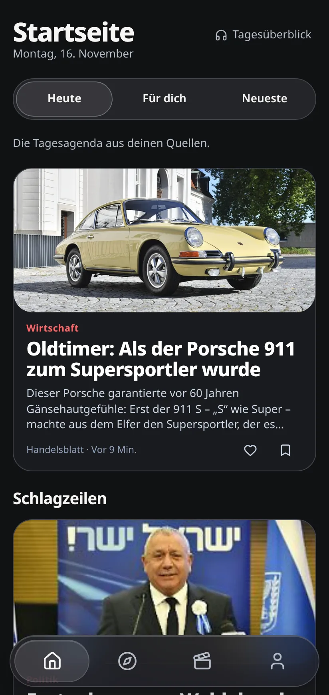

<div align="center">


# OpenNews

**Deine Nachrichten. Deine Quellen. Dein Gerät.**

Datenschutzfreundliche Nachrichten-App für RSS-, Atom-, JSON- und Podcast-Feeds — lokal personalisiert, ohne Konto und ohne Werbung.


</div>

---

> [!NOTE]
> **Aktueller Stand (`0.2.0`):** Die [Web-App](https://opennews-app.pages.dev/app/) (inkl. PWA) und die [Produktwebsite](https://opennews-app.pages.dev/) sind produktiv über Cloudflare Pages nutzbar. Die Android-App steht über Google Play / AAB-Release bereit (inkl. automatisiertem Cloud-Release-Workflow, siehe [PLAY_RELEASE_SETUP.md](PLAY_RELEASE_SETUP.md)). **iOS / WidgetKit** ist derzeit **nicht gebaut, nicht getestet und nicht verfügbar** (siehe [docs/ios-widget.md](docs/ios-widget.md)).

## Was ist OpenNews?

OpenNews bündelt Nachrichten, Videos, Podcasts und Live-Radio aus frei wählbaren Quellen in einer ruhigen Oberfläche:

- **Kein Konto, keine Cloud-Pflicht:** Quellenwahl, Reaktionen, Lesezeichen, Gewichte und Einstellungen liegen lokal auf dem Gerät (Schema v2 mit Quota-Schutz und JSON-Sicherung bis 5 MB).
- **Quellen & Sprachen:** 165 vorkonfigurierte Feeds in 6 Sprachen (`de`, `en`, `fr`, `es`, `it`, `pt`), 13 Starterpakete, 50 HTTPS-Radiosender, OPML-Import/-Export und beliebig viele eigene Feeds.
- **Nachvollziehbarer Reader:** Feed-Zusammenfassung als Standard, **Opt-in-Volltext pro Quelle**, Lesefortschritt, Zeitungsmodus, Vorlesen (Systemstimme + optionales BYOK-TTS) und lokale Zusammenfassungen.
- **Sicherheit by Design:** Strenge Origin-/Same-Origin-, Rate-Limit- und SSRF-Prüfungen in Web & Cloudflare Functions (`src/lib/apiCore.ts`). Web-API-Schlüssel bleiben standardmäßig in `sessionStorage`; auf Android schützt der hardwaregestützte Android Keystore (`SecureSecrets`).

## Screenshots

| Heute | Für dich | Artikel-Reader | Android-Widget |
| :---: | :---: | :---: | :---: |
|  |  |  |  |

## Schnellstart (Lokal)

Voraussetzungen: **Node.js 22+**, npm 10+ (zusätzlich **JDK 21** & **Android SDK** für native Android-Builds).

```bash
git clone https://github.com/mixxermannipro/OpenNews.git
cd OpenNews
npm ci
npm run dev          # Web-App + Express-API unter http://localhost:3000
```

Produktionsbuild & Prüfung:

```bash
npm run lint
npm test
npm run test:coverage
npm audit --omit=dev --audit-level=moderate
npm run build && node scripts/check-web-budget.mjs
npm run test:e2e
node scripts/check-docs-metrics.mjs
```

Für die Produktwebsite im Verzeichnis `apps/website/`:

```bash
cd apps/website && npm ci && npm run verify
```

## Architektur im Überblick

```text
OpenNews/
├── src/
│   ├── App.tsx                 # Shell, Navigation & Modale
│   ├── hooks/                  # Ausgelagerte State- & Speicher-Hooks
│   ├── components/             # Ansichten + reader/, settings/, sources/
│   └── lib/                    # Fachlogik, apiCore, storage, featureFlags, locales/
├── functions/api/[[path]].ts   # Cloudflare Pages Functions (/api/*)
├── server.ts                   # Express-Backend & Vite-/Produktionsserver
├── native/android/             # Capacitor-Plugins, Widget, Push (30/60 Min.), Android Auto
├── apps/website/               # Produktwebsite für Cloudflare Pages
├── e2e/                        # Playwright-Browsertests
├── scripts/                    # Pages-Build, Budget-, Doku- & Feed-Prüfung
└── docs/                       # Vertiefende Dokumentation
```

## Plattform-Status (`0.2.0`)

| Bereich | Status | Hinweis |
| --- | --- | --- |
| **Web-App & PWA** | Aktiv | Cloudflare Pages (`dist-pages/`), Service Worker mit Offline-Hinweis |
| **Android-App** | Aktiv | Capacitor 8, Widget, Push-Monitor (`30`/`60` Min.), Android Auto, Keystore |
| **Website** | Aktiv | Statischer Prerender unter `/` (`apps/website/`) |
| **iOS / WidgetKit** | Nicht verfügbar | Ungebaut und ungetestet; nur Entwurfsdateien in `native/ios/` |

Android-Build & Signierung:

```bash
npm run android:sync
cd android && ./gradlew testDebugUnitTest assembleDebug
# Release-AAB (Version-Code angeben):
npm run android:release -- 10
```

## Tests & Qualitätssicherung

- **Web-Unit-Tests:** 188 Tests in 34 Dateien (`npm test`, inkl. `npm run test:coverage` in der CI)
- **Android-JUnit-Tests:** 16 Tests in `OpenNewsAndroidUnitTests.java` (`./gradlew testDebugUnitTest`)
- **Playwright E2E:** 17 Browsertests in 3 Dateien (`core-flow.spec.ts`, `news.spec.ts`, `full-walkthrough.spec.ts`)
- **CI & Sicherheit:** Web-Budget-Limit (`170 KiB` gzip), `npm audit --omit=dev`, Dependabot, täglicher Feed-Health-Check & Doku-Metrikprüfung

## Dokumentation

Alle Details zu Funktionen, API-Routen, Umgebungsvariablen, Datenschutz und Release-Ablauf sind ausgelagert:

| Dokument | Thema |
| --- | --- |
| [docs/funktionen.md](docs/funktionen.md) | Vollständige Funktionsreferenz, Server-API, Env-Variablen & Speicher-Schlüssel |
| [PRODUCT.md](PRODUCT.md) | Abgrenzung Kernfunktionen (v0.2) vs. optionale Feature-Flags & Plattformstatus |
| [CHANGELOG.md](CHANGELOG.md) | Versionshistorie und Änderungen ab `0.2.0` |
| [docs/datenschutz.md](docs/datenschutz.md) | Datenschutzerklärung für Web und Android |
| [docs/artikelvolltext.md](docs/artikelvolltext.md) | Opt-in-Volltext, Readability, Opt-out & Offline-Kopien |
| [docs/quellen-rechte.md](docs/quellen-rechte.md) | Feed-Quellen, Urheberrecht, Paywalls & Takedown-Ablauf |
| [docs/android-release.md](docs/android-release.md) | Play-Store-Signierung, Android Vitals, 30/60-Min.-Intervall & Checkliste |
| [docs/android-widget.md](docs/android-widget.md) | Einrichtung und Größen des Android-Widgets |
| [docs/ios-widget.md](docs/ios-widget.md) | Hinweis zum nicht verfügbaren iOS-Status & Xcode-Referenz |
| [SECURITY.md](SECURITY.md) | Sicherheitsmodell und Meldeweg |
| [AGENTS.md](AGENTS.md) / [CONTRIBUTING.md](CONTRIBUTING.md) | Entwicklungsregeln, Git-Workflow & Beitragsrichtlinien |

## Lizenz

Open Source, **AGPL-3.0-or-later** ([LICENSE](LICENSE), [LICENSES/AGPL-3.0-or-later.txt](LICENSES/AGPL-3.0-or-later.txt)). Copyright (c) 2026 Manuel Blasaditsch. Bis Commit `d6cd0de2ab7fe5c97678fc9a04e62d2ee5dcd839` war der Code unter [Apache-2.0](LICENSES/Apache-2.0.txt) verfügbar und bleibt es in dieser Historie. Name und Logo von OpenNews sind nicht mitlizenziert ([TRADEMARKS.md](TRADEMARKS.md)). Drittschriften und -komponenten behalten ihre jeweiligen Lizenzen ([REUSE.toml](REUSE.toml)).

---

<div align="center">

**OpenNews** · `0.2.0` · November 2026

</div>
