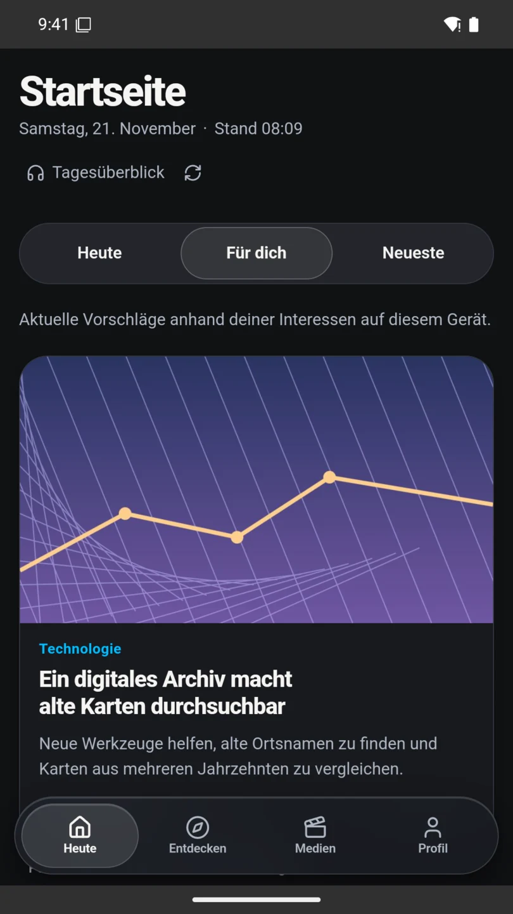
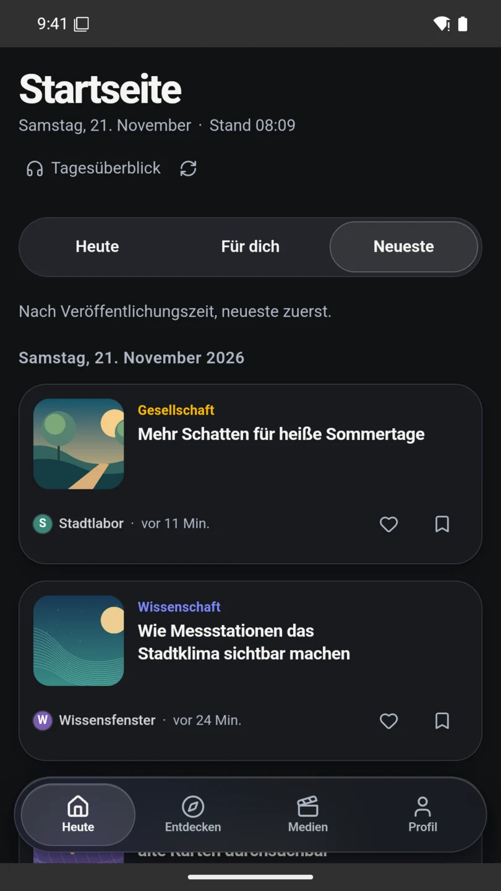
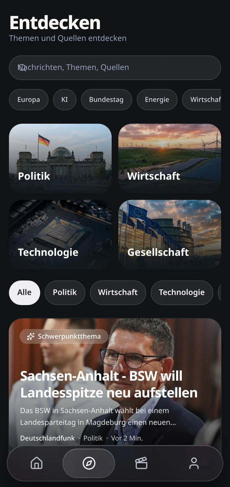
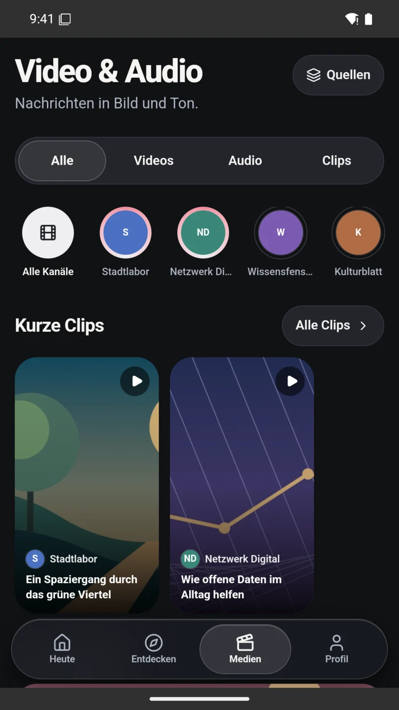
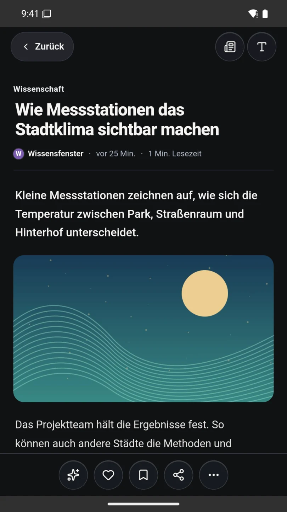
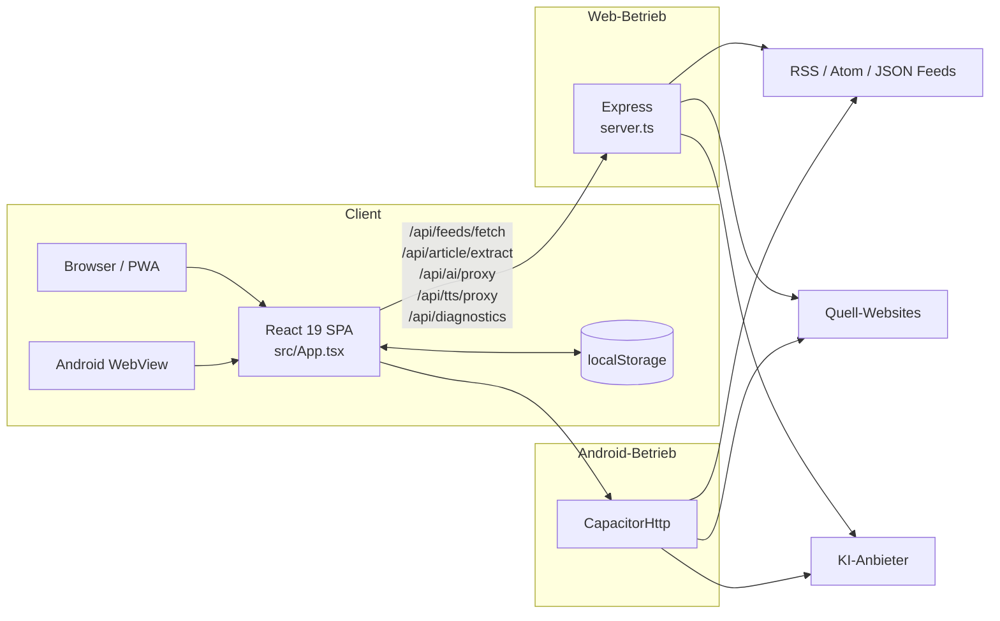

<div align="center">


# OpenNews

**Deine Nachrichten. Deine Quellen. Dein Gerät.**

Datenschutzfreundliche, Apple-inspirierte Nachrichten-App für freie RSS-, Atom- und JSON-Feeds — lokal personalisiert, optional mit eigener KI.

<br />


<br />

[Funktionen](#funktionen) · [Screenshots](#screenshots) · [Architektur](#architektur) · [Projektstruktur](#projektstruktur) · [Erste Schritte](#erste-schritte) · [Konfiguration](#konfiguration) · [Server-API](#server-api) · [Android](#android) · [Tests](#tests-und-qualität) · [Dokumentation](#dokumentation) · [Mitwirken](#mitwirken)

</div>

---

> [!NOTE]
> **Aktueller Stand (`0.1.0-alpha.1`):** Die Android-App ist im **Google Play Store** verfügbar. Die [Web-App](https://opennews-app.pages.dev/app/) läuft direkt im Browser und lässt sich als PWA installieren. Die [Produktwebsite](https://opennews-app.pages.dev/) zeigt die wichtigsten Ansichten. Artikelvolltext und KI mit eigenem Schlüssel sind Beta. Der iOS-Build mit WidgetKit wurde noch nicht in Xcode geprüft.

## Was ist OpenNews?

OpenNews bündelt Nachrichten aus frei zugänglichen Feeds in einer ruhigen Oberfläche. Statt eines undurchsichtigen Feed-Algorithmus entscheidest du selbst über deine Quellen — und die App lernt ausschließlich auf deinem Gerät, was dir gefällt.

- **Kein Konto, keine Cloud-Pflicht.** Abos, Likes, Lesezeichen und Einstellungen liegen im lokalen Speicher.
- **Freie Quellen.** RSS 2.0, RSS 1.0/RDF, Atom 1.0 und JSON Feed 1.0/1.1.
- **Nachvollziehbare Empfehlungen.** Sichtbare Gewichte für Thema, Quelle, Schlagwörter und Aktualität.
- **KI nur auf Wunsch.** Quelleninhalte werden getrennt von den KI-Anweisungen übergeben. Die App prüft das Format der Antwort. Lokale Zusammenfassung ist immer da; ein eigenes Sprachmodell ist optional (BYOK).
- **Eine Codebasis.** React im Browser, dieselbe Oberfläche als PWA und als Capacitor-App auf Android; iOS ist mit WidgetKit-Dateien vorbereitet.

## Funktionen

| Bereich | Umfang |
| --- | --- |
| **Quellen** | 165 vorkonfigurierte internationale Feeds in 6 Sprachen (DACH, UK/US/Global, Frankreich, Spanien/Lateinamerika, Italien, Portugal/Brasilien) inkl. internationaler YouTube-Kanäle, Shorts und Podcasts (u. a. Tagesschau 20 Uhr, Tagesthemen, ZDF heute journal, NDR Info, DLF, SRF Echo der Zeit) plus beliebig viele eigene Feeds; standardmäßig ist keine Quelle vorausgewählt (Start über 1-Tipp-Auswahl oder 13 Starterpakete) |
| **Quellensuche** | Gewichtete Relevanzsuche nach Medium, Domain, Land/Region, Sprache, Thema (mehrsprachig), Schlagwörtern und Format; fehlertolerant bei Umlauten und Akzenten; Sprach-, Typ-, Auswahl- und Themenfilter |
| **Mehrsprachigkeit** | 6 App-Sprachen (**Deutsch**, **English**, **Français**, **Español**, **Italiano**, **Português**) mit automatischer Systemspracherkennung, direktem Wechsel im Onboarding & Profil und lokalisierten Datums-/Zeitformaten |
| **Feed-Formate** | RSS 2.0, RDF, Atom 1.0, JSON Feed, Podcast-Feeds; Domain-Erkennung über `link rel="alternate"`; OPML-Import/-Export |
| **Startseite** | **Heute** (Titelseite mit Aufmacher, Schlagzeilen-Spalte, Ressort-Schnellfilter, Mehrquellen-Icons & Werbungsfilter), **Für dich** (48 h, personalisiert), **Neueste** (streng chronologisch); **Ungelesen-Filter** mit dezentem Gelesen-/Lesefortschritts-Hinweis, **1-Tipp-Warteschlange** („Später lesen“) direkt auf Artikelkarten, elastisches Pull-to-Refresh, direkter Aktualisieren-Button mit Zeitstempel, neue Meldungen ohne Sprung beim Lesen, **Wischgeste („Weniger davon“)** links/rechts auf Heute & Für dich mit Rückgängig-Hinweis, ruhiger Abschluss („Auf dem neuesten Stand“), weitere Quellen je Geschichte, Datumsabschnitte in Neueste |
| **Personalisierung** | Like, Dislike, Wischgeste („Weniger davon“), Lesezeichen, Lesezeit und Verlauf formen lokale Gewichte für Themen, Quellen und Schlagwörter (wirken auf Für dich und sanft auf Heute; Neueste bleibt streng chronologisch); Vielfalt mischt Quellen und Themen; gelernte Interessen verblassen mit der Zeit |
| **Reader** | Volltext-Extraktion mit Feed-Fallback, **Weiterlesen-Position** (gespeicherter Lesestand pro Artikel mit Rücksprung-Hinweis), **Vor-/Zurück-Navigation** im Feed-Kontext inkl. Desktop-Tastaturkürzeln (`←`/`→`, `j`/`k`, `b`, `q`, `n`, `Esc`), **Paywall-Hinweis mit freien Themen-Alternativen** aus dem Cluster, einklappbare **Kapitel-Sprungleiste** ab 3 Zwischenüberschriften, Lesefortschrittslinie im Kopf, intelligente Offline-Vorladung im Hintergrund (beachtet `saveData` und langsame Netze), **Zeitungsmodus** (Fokusmodus mit Zeitungskopf, Initiale und 2-Spalten-Layout ab 900 px), Lesethemen (**Papier [Standard] / Sepia / Nacht / Standard**), **Vorlesen 2.0** (absatzweises synchrones Mitlesen mit Markierung, Tempo, Sleep-Timer sowie Multi-Anbieter-Stimmen inkl. Google AI Studio Gemini TTS, OpenAI, ElevenLabs & Systemstimme), lokale Text-Markierungen & Zitate, Lese-Warteschlange („Als Nächstes lesen“), intelligente Themen-Verlinkung zu passenden Videos, Clips & Podcasts in der App sowie „Was bisher geschah“-Kontext |
| **Vorlesen & Stimmen (TTS)** | Konfigurierbare Vorlesestimmen je Szenario (**Artikel**, **Tagesüberblick**, **Ruhiger Fokus / Zeitungsmodus**) mit **Google AI Studio (`gemini-3.8-flash-lite-tts` / `gemini-3.8-flash-tts`, kostenloser API-Key)**, **OpenAI Speech**, **ElevenLabs**, eigenen OpenAI-kompatiblen HTTPS-Endpunkten oder **Systemstimme (offline)**; nahtloses Vorladen des nächsten Absatzes, lokaler Audio-Cache & automatischer Rückfall auf die Systemstimme |
| **Video, Audio & Clips** | Redaktioneller Medien-Hub mit Mediensuche, Format-Reitern (`Alle`, `Videos`, `Audio`, `Radio`, `Clips`) mit Zählern, tab-abhängiger Kanal-Leiste, „Weiterhören“-Regal, **Live-Nachrichtenradio** (24 geprüfte HTTPS-Sender aus DACH & aller Welt inkl. DLF, ARD-Inforadios, SRF 4 News, ORF Ö1, BBC World Service, NPR, France Info mit Favoriten und Live-Schnellleiste), 9:16-Shorts-Reihe, 16:9-Video-Grid (inkl. 16:9-YouTube-Vorschaubildern und Theater-Bühne mit Shownotes), Podcast-Audio-Deck mit Laufzeit & Episoden-Notizen, **persistentem Mini-Audio-Player** (Podcast-Scrubber, automatische Warteschlange, Live-Radio-Modus & Fehler-Fallback), vollflächigem Clips-Feed sowie direkter Medienkanal-Entdeckung. Große Podcast-RSS-Feeds werden per Präfix-Kürzung zuverlässig eingelesen. |
| **Medientranskripte** | Verlinkte VTT-, SRT- und Text-Transkripte von Podcast- oder Video-Feeds auf Wunsch per KI zusammenfassen. |
| **KI auf dem Gerät** | Gemini Nano auf unterstützten Chrome- und Android-Geräten. Zudem 100 % lokale Artikeltyp-Erkennung (`Meinung`, `Analyse`, `Interview`, `Faktencheck`, `Eilmeldung`), Clickbait-Entschärfer und lokales Story-Radar. |
| **KI-Zusammenfassungsstile** | Kernaussagen, 5 W-Fragen, Einfach erklärt (B1) und Auf Englisch. Standard in den KI-Einstellungen, Auswahl auch am Artikel. |
| **Frag den Artikel** | Fragen in der KI-Zusammenfassung stellen. Antworten zeigen ein wörtliches Zitat aus dem Artikel, wenn ein Beleg vorliegt. |
| **Perspektiven vergleichen** | Bei Meldungsgruppen mit mindestens zwei Quellen vergleicht die eingerichtete KI Schwerpunkte und Wortwahl – auch sprachübergreifend – und zeigt die beteiligten Quellen an. |
| **Wochenrückblick** | Die eingerichtete KI fasst bis zu acht der zuletzt veröffentlichten Beiträge aus Lesezeichen und Likes thematisch zusammen. |
| **Tagesüberblick 2.0** | Kompakter Einstieg im Kopf der Startseite. Synthetisiert lokal und ohne API-Key ein strukturiertes Themen-Briefing mit Begrüßung, gebündelten Stichpunkten, Quellenangaben, „Kurz notiert“, **durchgängigem Mini-Player über alle Tabs** (inkl. Vor/Zurück-Sprung und direktem Artikel-Einstieg) und synchronem Vorlesen (inkl. Szenario-Stimme); optional mit eigener KI (BYOK) vertiefbar. |
| **Entdecken** | Ressort-Leiste mit Trefferzahlen, quellen-diversifiziertes Aufmacher-/Bento-Spotlight (ohne Werbebeiträge), lokales Story-Radar („Gerade viel besprochen“), einklappbarer Stichwort-Radar & Stummschalt-Filter (24 Std. / 7 Tage / dauerhaft), kompakte Themenwelten, neue Quellen & Perspektiven (Neu entdecken, International, Video & Podcasts, Starter-Pakete), umlaut-tolerante Volltextsuche mit Live-Vorschlägen, Sortierung (`Relevanz`/`Neueste`), Medien-Filter und 1-Tipp-Radar-Übernahme |
| **Darstellung & Profil** | Vollständig in 6 Sprachen lokalisierte Einstellungen: System/Hell/Dunkel, Akzentfarbe, Kartendichte, Textgröße, Bilder im Feed, reduzierte Bewegung, Lesethema & Zeitungsmodus direkt unter **Profil → Lesen** |
| **Sicherung** | Export und Import von Abos, Reaktionen und Lesezeichen als JSON-Datei bis 5 MB; bleibt auf dem Gerät |
| **Diagnose** | Freiwillige lokale Fehleraufzeichnung ohne Fehlertexte, Adressen oder Gerätekennungen; Export als JSON, optionales Senden der Fehlerart an den eigenen Server |
| **Widget** | Scrollbarer Android-Feed mit Größenanpassung, Filter, Erscheinungsbild und konfigurierbarer Hintergrund-Aktualisierung (Aus, 15/30 Min., 1/2/4 Std.) je Widget; iOS-WidgetKit für drei Größen mit Reitern, benötigt Xcode |
| **PWA** | Installierbar, Service Worker mit Auto-Update, Offline-Hinweis, maskierbares Icon |
| **Android** | Capacitor-WebView, direkte HTTP-Aufrufe, nativer Zurück-Knopf, Share-Dialog, Systemstimme und lokale Übersetzung |
| **Android Auto** | Vollständige Media3-/ExoPlayer-Integration (`OpenNewsAutoMediaService`) mit 4 Fahrzeug-Tabs (**Nachrichten-Updates** inkl. „Alle aktuellen Updates abspielen“ und Tagesschau 20 Uhr auch vom Vortag, **Podcasts**, **Live-Radio** mit 24 Sendern, **Warteschlange**), eigenständigem HTTPS-Feed-Abruf im Auto, ±15-Sekunden-Sprüngen, Lenkrad- & Sprachsuche, Playback Resumption und App-Sync/Einstellungen unter **Profil → Lesen** |
| **Benachrichtigungen** | Android-Push für unterstützte abonnierte Quellen mit eingerichtetem Firebase. Im Web erscheinen Hinweise in der geöffneten App. |

**Aufbewahrung:** 2, 4, 7, 14, 30 oder 90 Tage (Standard **4**), maximal **600** Beiträge im Speicher. Beim Aktualisieren werden neue Artikel zusammengeführt; Abos, Lesezeichen, Likes und Verlauf bleiben erhalten.

**Einstellungen & Hinweise:** Die Android-Benachrichtigungsfreigabe erscheint beim Einschalten von Eilmeldungen oder der täglichen Erinnerung. Automatische Übersetzung steht unter **Lesen**, das Zurücksetzen der Empfehlungen unter **KI & Personalisierung**, Sicherung und Diagnose unter **Datenschutz**, und reduzierte Bewegung unter **Profil → Einstellungen → Darstellung**.

## Screenshots

Aufnahmen aus Android 16 vom 21. November 2026. Die App zeigt Beispielmeldungen im dunklen Modus.

| Heute | Für dich | Neueste |
| :---: | :---: | :---: |
|  |  |  |

| Entdecken | Video & Audio | Artikel-Reader |
| :---: | :---: | :---: |
|  |  |  |


[Android-Widget einrichten und anpassen](docs/android-widget.md)

Die [Regeln für die Inhaltsauswahl](docs/content-ranking.md) und die [mobile Vergleichsstichprobe](docs/benchmark-72.md) dokumentieren die Auswahl.

## Architektur

React-SPA, schlanker Express-Server für den Web-Betrieb und eine Capacitor-Hülle für Android. Die Fachlogik liegt in `src/lib/` und ist frameworkunabhängig testbar.



| Modus | Start | Netzwerkpfad |
| --- | --- | --- |
| Entwicklung | `npm run dev` | Browser → Vite-Middleware → Express-Routen (Port `3000`) |
| Web-Produktion | `npm run build` + `NODE_ENV=production npm start` | Browser → Express → Feeds/Websites/KI |
| PWA | installierte Web-App | wie Produktion; Assets im Service-Worker-Cache |
| Android | Google Play Store / APK | WebView → `CapacitorHttp` → Feeds/Websites/KI (kein Node-Server) |

**Datenfluss:** Feed-URL → HTTP-Abruf → `parseFeedPayload()` → Normalisierung (Titel, Datum, Kategorie, Schlagwörter, Medien, Lesezeit) → `mergeFeedArticles()` (Merge, Aufbewahrung, 600er-Limit) → `buildHomeSections()` → React-Oberfläche.

## Technologie-Stack

| Ebene | Technologie |
| --- | --- |
| UI | React 19, CSS-Animationen, lucide-react |
| Sprache | TypeScript 7 |
| Build | Vite 8 |
| Styling | Tailwind CSS 4 |
| Feed-Parsing | fast-xml-parser 5 |
| Server | Express 4, Helmet, express-rate-limit |
| Sicherheit | `publicHttp.ts` prüft jede Adresse per DNS und erlaubt nur öffentliche Ziele |
| PWA | vite-plugin-pwa 2 |
| Android | Capacitor 8 |
| Tests | Node Test Runner mit tsx, Playwright für Browsertests |
| CI | GitHub Actions (Typecheck, Unit-Tests, Build, Web-Budget, E2E, Debug-APK) |

## Projektstruktur

Dieses Repository enthält die App und die [Produktwebsite](apps/website/README.md).
Die Website hat eigene Abhängigkeiten und einen eigenen Build. Für den gemeinsamen
Cloudflare-Pages-Deploy (Website unter `/` und Web-App unter `/app/` samt
Cloudflare Pages Functions unter `functions/api/`) baut `npm run build:pages`
beide Teile in `dist-pages/`. Die Anleitung im Website-Ordner beschreibt
die Live-Konfiguration.

Versionierte Ordner und Dateien. Bilddateien sind gruppiert; generierte Ordner stehen darunter.

```text
OpenNews/
├── .github/
│   └── workflows/
│       ├── android-test-apk.yml        # CI: Android-Debug-APK und Pre-Release
│       ├── web-ci.yml                  # CI: App-Typen, Tests, Build, Web-Budget, E2E
│       └── website-ci.yml              # CI: Website-Build und Tests
│
├── apps/
│   └── website/                        # Produktwebsite für Cloudflare Pages
│
├── docs/
│   ├── screenshots/                    # Ergänzende App-Aufnahmen (README nutzt apps/website/public/screenshots/)
│   ├── android-release.md              # Signierung und Play-Store-Checkliste
│   ├── artikelvolltext.md              # Readability, Rechte, Offline-Kopien
│   ├── datenschutz.md                  # Entwurf der Datenschutzerklärung
│   ├── ios-widget.md                   # WidgetKit und iOS-Einrichtung
│   └── monetarisierung.md              # Preis- und Erlösmodell
│
├── functions/
│   └── api/
│       └── [[path]].ts                 # Cloudflare Pages Functions (/api/* für die Web-App)
│
├── e2e/
│   ├── full-walkthrough.spec.ts        # End-to-End-Komplettprüfung aller Ansichten und Dialoge
│   └── news.spec.ts                    # Browsertests für Kernabläufe
│
├── native/
│   ├── android/
│   │   ├── AndroidAutoSync.java        # Capacitor-Brücke für Android Auto (Abos, Favoriten, Warteschlange)
│   │   ├── AutoAudioCatalog.java       # Katalog für Nachrichten-Updates, Podcasts & 24 Live-Radiosender
│   │   ├── AutoAudioStore.java         # Lokaler Android-Auto-Speicher (Positionen, Warteschlange, Cache)
│   │   ├── AutoFeedFetcher.java        # Nativer HTTPS-Podcast-Fetcher für Android Auto
│   │   ├── BriefingSpeech.java         # Systemstimme für den Tagesüberblick
│   │   ├── LocalTranslation.java       # Lokale Übersetzung auf Android
│   │   ├── MainActivity.java           # Zurück-Navigation, Plugin-Registrierung und ArticleShare
│   │   ├── NewsMessagingService.java   # Firebase-Nachrichten
│   │   ├── NewsPush.java               # Push-Registrierung
│   │   ├── NewsWidget.java             # Widget-Brücke
│   │   ├── OpenNewsAutoMediaService.java # Media3/ExoPlayer MediaLibraryService für Android Auto
│   │   ├── OpenNewsWidget.java         # Android-Widget
│   │   ├── WidgetFeed.java             # Filter und Meldungszeilen
│   │   ├── WidgetFeedService.java      # Scrollbare Liste bis Android 11
│   │   ├── WidgetRefreshService.java   # Konfigurierbare Hintergrund-Aktualisierung (JobScheduler)
│   │   ├── auto/                       # Android-Auto-Deskriptor und Vektor-Icons
│   │   ├── auto-manifest.xml           # Android-Auto-Metadaten & MediaLibraryService-Eintrag
│   │   ├── widget/                     # Layout, Bilder und Farben des Widgets
│   │   ├── sync-icons.sh               # Launcher-Icons aus dem Logo
│   │   └── sync-plugins.sh             # Native Dateien ins Android-Projekt kopieren
│   └── ios/
│       ├── NewsWidgetPlugin.swift
│       ├── OpenNewsBridgeViewController.swift
│       └── OpenNewsWidget.swift
│
├── public/
│   ├── apple-touch-icon.png
│   ├── icon.svg
│   ├── logo.png
│   ├── pwa-192x192.png
│   ├── pwa-512x512.png
│   ├── pwa-maskable-512x512.png
│   └── theme-init.js                   # Theme vor dem ersten Rendern setzen
│
├── scripts/
│   ├── build-pages.mjs                 # Baut Website + Web-App für Cloudflare Pages in dist-pages/
│   ├── check-web-budget.mjs            # Prüft das JS-Budget von 170 KiB gzip
│   └── push-news.ts                    # Feed-Dienst für Android-Push
│
├── src/
│   ├── assets/images/                  # Redaktionelle Bilder für Demo-Artikel
│   │
│   ├── components/                     # React-Komponenten
│   │   ├── ArticleCards.tsx            # Aufmacher- und Kompaktkarten
│   │   ├── ArticleImage.tsx            # Bild mit Quellen-Fallback
│   │   ├── ArticleMedia.tsx            # Medien im Reader
│   │   ├── ArticleReaderModal.tsx      # Reader-Sheet, Zusammenfassung, Teilen
│   │   ├── AudioBriefing.tsx           # Tagesüberblick und Vorlesen
│   │   ├── ClipsFeed.tsx               # Vollbild-Clips-Feed (Vertikal-Snap, Aktionsleiste, Doppeltipp)
│   │   ├── DiagnosticsSettings.tsx     # Freiwillige Diagnose
│   │   ├── DiscoverSearch.tsx          # Suche, Vorschläge, letzte Suchen
│   │   ├── DiscoverView.tsx            # Themen- und Quellenübersicht
│   │   ├── HomeView.tsx                # Heute / Für dich / Neueste
│   │   ├── MediaPlayer.tsx             # Podcast-Audio-Deck, Video- und YouTube-Player
│   │   ├── MediaView.tsx               # Medien-Hub (Kanal-Stories, Shorts-Reihe, Videos, Audio, Live-Radio)
│   │   ├── MiniAudioPlayer.tsx         # Persistenter schwebender Podcast- & Live-Radio-Player
│   │   ├── Preferences.tsx             # Onboarding, Profil, Darstellung, Android-Auto-Optionen
│   │   ├── PWAInstallButton.tsx        # Installationshilfe und Offline-Hinweis
│   │   ├── SavedView.tsx               # Lesezeichen, Warteschlange, Zitate, Likes, Verlauf
│   │   ├── SettingsView.tsx            # Einstellungen, KI, Benachrichtigungen
│   │   ├── SourceIcon.tsx              # Quellen-Logo mit Initialen-Fallback
│   │   └── SourcesManager.tsx          # Quellenübersicht, Suche, Filter, Starterpakete
│   │
│   ├── hooks/
│   │   ├── useArticleStorage.ts        # Quota-sichere Artikelablage
│   │   ├── useLocalStorage.ts          # Typsicherer localStorage-Hook
│   │   └── usePWAInstall.ts            # Installierbarkeit und Online-Status
│   │
│   ├── lib/                            # Fachlogik, unabhängig von React
│   │   ├── aiClient.ts                 # BYOK-Anbieter, Prompt, Tagesüberblick, Kontext
│   │   ├── androidAuto.ts              # Payload-Builder & Capacitor-Bridge für Android Auto (lazy)
│   │   ├── articleExtraction.ts        # Volltext mit Mozilla Readability
│   │   ├── articleMedia.ts             # Abspielbare Medien eines Artikels
│   │   ├── catalog.ts                  # 165 internationale Quellen (Standard: abgewählt), 13 Starterpakete
│   │   ├── clipsEngine.ts              # Clip-Playlist, Medienkanäle, Weiterhören, Mediensuche & Quellen-Entdeckung
│   │   ├── contentIdentity.ts          # Gleiche Beiträge erkennen
│   │   ├── dailyBriefingSynth.ts       # Lokale Tagesüberblick-Synthese in 6 Sprachen
│   │   ├── deviceBackup.ts             # Sicherung exportieren und lesen
│   │   ├── diagnosticEvents.ts         # Erlaubte Fehlerarten
│   │   ├── diagnostics.ts              # Lokale Diagnose
│   │   ├── discoverCopy.ts             # Lokalisierte Entdecken-Texte (6 Sprachen, lazy)
│   │   ├── discoverEngine.ts           # Quellen-diversifiziertes Entdecken, Umlaut-Suche & Live-Vorschläge
│   │   ├── feedRefresh.ts              # Priorisierte Feed-Batches & Parallelität
│   │   ├── i18n.tsx                    # 6-Sprachen-Engine (DE/EN inline, FR/ES/IT/PT lazy in locales/)
│   │   ├── keywordFilter.ts            # Stummschalt-Filter (mit Ablaufzeit) & Stichwort-Radar
│   │   ├── localEditorialAI.ts         # Artikeltyp-Erkennung, Clickbait-Entschärfer & Story-Radar
│   │   ├── localTranslation.ts         # Android-Übersetzung
│   │   ├── mediaCopy.ts                # Lokalisierte Medien-Texte (6 Sprachen, lazy)
│   │   ├── nativeFeed.ts               # CapacitorHttp und Feed-Erkennung
│   │   ├── newsFeed.ts                 # Merge, Aufbewahrung, Startseiten
│   │   ├── newsPush.ts                 # Push-Themen
│   │   ├── newsWidget.ts               # Widget-Daten
│   │   ├── offlineArticle.ts           # Offline-Kopien
│   │   ├── offlinePreload.ts           # Intelligente Offline-Vorladung im Hintergrund
│   │   ├── opml.ts                     # OPML 2.0 lesen und schreiben
│   │   ├── personalization.ts          # Profil, Gewichte, Scoring
│   │   ├── preferences.ts              # Presets, Sprache, Aufbewahrung, Defaults
│   │   ├── publicHttp.ts               # SSRF-Schutz und Größenlimit
│   │   ├── pullPhysics.ts              # Pull-to-Refresh-Dämpfung & Lesefortschritt
│   │   ├── radioCatalog.ts             # 24 geprüfte HTTPS-Live-Nachrichtenradios & Filter (lazy)
│   │   ├── readerCopy.ts               # Lokalisierte Reader- & Briefing-Texte (6 Sprachen, lazy)
│   │   ├── readerExtras.ts             # Vorlesen-2.0-Blöcke, Lesefortschritt, Vor/Zurück, Alternativen, Audio-Positionen & Warteschlange
│   │   ├── relatedMedia.ts             # Themen-Verlinkung (Artikel ↔ Video/Clip/Podcast) & Vorgeschichte
│   │   ├── rssParser.ts                # Feed-Parser und Normalisierung
│   │   ├── scrollNavigation.ts         # Scroll-Richtung und Schwellwerte
│   │   ├── settingsCopy.ts             # Lokalisierte Profil- & Einstellungs-Texte (6 Sprachen, lazy)
│   │   ├── shareArticle.ts             # Nativer Share-Dialog
│   │   ├── sourceSearch.ts             # Gewichtete Quellensuche (Umlaute/Akzente/Region/Sprache)
│   │   ├── storyClusters.ts            # Ähnliche Meldungen bündeln
│   │   ├── swipePhysics.ts             # Wischgesten-Physik („Weniger davon“) mit Scroll-Schutz
│   │   ├── ttsClient.ts                # Multi-Anbieter-TTS je Szenario, WAV-Header & Audio-Cache
│   │   └── *.test.ts                   # 29 Testdateien
│   │
│   ├── types/news.ts                   # Artikel, Quellen, Profil, KI
│   ├── App.tsx                         # App-Zustand, Navigation, Feed-Abruf
│   ├── index.css                       # Design-Tokens, Glas-Optik, Dark Mode
│   └── main.tsx                        # React-Root
│
├── .env.example                        # Vorlage für Server-Variablen
├── .gitignore
├── AGENTS.md                           # Regeln für Agenten und Mitwirkende
├── CODE_OF_CONDUCT.md
├── CONTRIBUTING.md
├── DESIGN.md                           # Gestaltungsleitlinien
├── LICENSE
├── PRODUCT.md                          # Produktbeschreibung
├── README.md                           # Diese Datei
├── SECURITY.md
├── capacitor.config.ts                 # App-ID, WebView, CapacitorHttp
├── index.html                          # HTML-Shell und Meta-Tags
├── package.json                        # Abhängigkeiten und Skripte
├── package-lock.json                   # Festgeschriebene npm-Abhängigkeiten
├── playwright.config.ts                # Browsertests gegen den Produktionsbuild
├── server.ts                           # Express-API und Vite-/Produktions-Server
├── tsconfig.json                       # TypeScript-Konfiguration
└── vite.config.ts                      # React, Tailwind, PWA, Alias
```

### Generierte Ordner

| Ordner | Entstehung | Hinweis |
| --- | --- | --- |
| `node_modules/` | `npm ci` | Abhängigkeiten |
| `dist/` | `npm run build` | Produktionsbuild inkl. Service Worker |
| `dev-dist/` | Vite-PWA im Dev-Modus | Nicht versioniert |
| `android/` | `npx cap add android` | Nicht versioniert; CI erzeugt es bei jedem Lauf |
| `android/app/build/` | Gradle | Debug-APK und Zwischendateien |
| `playwright-report/`, `test-results/` | `npm run test:e2e` | Berichte der Browsertests |
| `coverage/` | Testabdeckung | Nur bei entsprechender Konfiguration |

> [!IMPORTANT]
> `android/` ist **nicht** Teil des Repositories. Der Sync übernimmt den nativen Code und die Einstellungen aus `native/android/`.

## Erste Schritte

### Voraussetzungen

| Werkzeug | Version | Benötigt für |
| --- | --- | --- |
| Node.js | 22.18+ oder 24 LTS | Entwicklung, Build, Tests |
| npm | 10+ | Installation und Skripte |
| JDK | 21 | Android-Build |
| Android SDK | aktuell | Android-Build (Android Studio empfohlen) |
| ImageMagick (`magick` oder `convert`) | aktuell | Launcher-Icons beim Android-Sync |

Für Web und PWA genügen Node.js und npm.

### Installation und Start

```bash
git clone https://github.com/mixxermannipro/OpenNews.git
cd OpenNews
npm ci
npm run dev          # http://localhost:3000
```

Wenn du eine npm-Abhängigkeit änderst, aktualisiere auch die `package-lock.json` und prüfe die Installation mit `npm ci`.

### Produktionsbuild

```bash
npm run build
NODE_ENV=production npm start
```

> [!TIP]
> `npm run preview` zeigt nur den statischen Vite-Build. Die `/api/...`-Routen stehen dort **nicht** zur Verfügung.

### In der App

1. **Onboarding:** Sprache, erste Nachrichtenquellen (oder Starterpaket), Themenschwerpunkte und Darstellung wählen.
2. **Quellen:** Unter **Profil → Quellen** internationale Medien durchsuchen, per 1-Tipp an-/abwählen oder eigene Feeds ergänzen.
3. **Aktualisieren:** Beim Start automatisch; auf Touch-Geräten nach unten ziehen.
4. **Lesen:** Artikel antippen — der Reader lädt nach Möglichkeit den Volltext.
5. **Personalisieren:** Like, Dislike, Lesezeichen und Lesezeit formen die Empfehlungen.
6. **KI (optional):** Unter **Profil → KI & Personalisierung** Anbieter und Schlüssel hinterlegen.
7. **Installieren:** Installationshilfe für PWA im Profil; die Android-App ist im Google Play Store verfügbar.

## Skripte

| Befehl | Ausführung | Zweck |
| --- | --- | --- |
| `npm run dev` | `tsx server.ts` | Dev-Server mit Vite-Middleware auf Port `3000` |
| `npm run build` | `vite build` | Produktionsbuild nach `dist/` inkl. PWA-Assets |
| `npm run build:pages` | `node scripts/build-pages.mjs` | Baut Website und Web-App zusammen nach `dist-pages/` |
| `npm start` | `tsx server.ts` | Express starten; mit `NODE_ENV=production` aus `dist/` |
| `npm run preview` | `vite preview` | Statischen Build ansehen (ohne API) |
| `npm run lint` | `tsc --noEmit` | TypeScript-Typprüfung |
| `npm test` | `node --import tsx --test src/lib/*.test.ts` | 151 Unit-Tests |
| `npm run test:e2e` | `playwright test` | 16 Browsertests |
| `npm run push:worker` | `tsx scripts/push-news.ts` | Android-Push aus den Standardquellen senden |
| `node scripts/check-web-budget.mjs` | Node | Prüft das Start-JavaScript gegen 170 KiB gzip |
| `npm run clean` | `rm -rf dist server.js` | Build-Artefakte entfernen |
| `npm run android:sync` | Build + `cap sync` + MainActivity + Icons | Web-Assets, natives Projekt und App-Symbole abgleichen |
| `npm run android:release -- <code >` | `bash native/android/build-release.sh` | Signiertes Android App Bundle (`.aab`) für Google Play bauen |

## Konfiguration

### Umgebungsvariablen

| Variable | Standard | Bedeutung |
| --- | --- | --- |
| `PORT` | `3000` | Port des Express-Servers |
| `NODE_ENV` | nicht gesetzt | `production` liefert `dist/` aus und aktiviert CSP/HSTS, sonst wird Vite eingebunden |
| `DISABLE_HMR` | nicht gesetzt | `true` deaktiviert Hot Reload und Watch (nur Entwicklung) |
| `OPENNEWS_ORIGIN` | Anfrage-Host | Erlaubte Herkunft für `/api/*` hinter einem Reverse-Proxy, z. B. `https://news.example.org` |
| `OPENNEWS_TRUST_PROXY` | nicht gesetzt | IP-Adressen oder Netzbereiche eigener Reverse-Proxys, mit Komma getrennt. Nur dann nutzt Express die weitergereichte Client-IP für Anfragelimits. Der öffentliche Proxy muss eingehende Weiterleitungsheader ersetzen. |
| `OPENNEWS_DIAGNOSTICS` | nicht gesetzt | `1` aktiviert den Empfang freiwilliger Fehlerberichte unter `/api/diagnostics` |
| `OPENNEWS_FIREBASE_PROJECT` | nicht gesetzt | Firebase-Projekt-ID für `npm run push:worker` (Pflicht dort) |
| `OPENNEWS_PUSH_STATE` | `./opennews-push-state.json` | Datei mit bereits versendeten Meldungen |

> [!WARNING]
> `.env.example` enthält weiterhin Platzhalter aus der ursprünglichen AI-Studio-Vorlage (`GEMINI_API_KEY`, `APP_URL`). Der Server liest sie **nicht**. API-Schlüssel gehören in die App unter **Profil → KI & Personalisierung**. Die `OPENNEWS_*`-Zeilen sind auskommentiert und müssen im Server-Prozess gesetzt werden.

Die Quellenverwaltung nutzt öffentliche Feeds. Eigene Zugangsschlüssel lassen sich für die optionalen KI-Anbieter hinterlegen.

### Lokaler Speicher

OpenNews nutzt ausschließlich `localStorage` (JSON). Die wichtigsten Schlüssel:

| Schlüssel | Inhalt |
| --- | --- |
| `opennews_preferences` | Darstellung, Startseite, Aufbewahrung, Preset, Themen |
| `opennews_sources` | Quellen, Abos und eigene Feeds |
| `opennews_profile` | Likes, Dislikes, Lesezeichen, Verlauf, Gewichte |
| `opennews_ai_config` | BYOK-Anbieter, Schlüssel, Modell, Endpunkt |
| `opennews_tts_config` | Vorlese-Anbieter, API-Schlüssel & Stimmen/Modelle je Szenario (`article`, `briefing`, `focus`) |
| IndexedDB `opennews-ai` | Lokale KI-Ergebnisse, befristet wie der Feed (standardmäßig vier Tage) |
| `opennews_cached_articles` | Zuletzt geladene Beiträge (max. 600) |
| `opennews_saved_articles` | Offline-Kopien von Lesezeichen und Likes |
| `opennews_read_articles` | Leseverlauf (max. 60) |
| `opennews_notifications` | Benachrichtigungsregeln und Zeitfenster |
| `opennews_recent_searches` | Letzte sechs Suchbegriffe |
| `opennews_feed_health` | Letzter Abrufstatus je Quelle |
| `opennews_formats` | Bevorzugte Medienformate |
| `opennews_auto_translate` | Lokale Übersetzung englischer Quellen auf Android |
| `opennews_background_playback` | Weiterhören im Hintergrund |
| `opennews_diagnostics`, `opennews_diagnostics_enabled`, `opennews_diagnostics_reports` | Lokale Diagnose, Einwilligung und Versandfreigabe |
| `opennews_theme`, `opennews_onboarded`, `opennews_font_size`, `opennews_font_family`, `opennews_reader_theme`, `opennews_newspaper_mode` | Theme, Onboarding, Reader-Typografie, Lesethema & Zeitungsmodus |
| `opennews_muted_keywords`, `opennews_tracked_keywords` | Stummschalt-Filter (mit Ablaufzeit) & Stichwort-Radar |
| `opennews_highlights`, `opennews_reading_queue`, `opennews_reading_progress`, `opennews_audio_positions` | Lokale Text-Markierungen, Lese-Warteschlange, Artikel-Lesefortschritt & Podcast-Positionen |
| `opennews_radio_favorites`, `opennews_android_auto` | Gespeicherte Radio-Favoriten & Android-Auto-Einstellungen |

Bei Parse- oder Quota-Fehlern fällt der Hook auf den Standardwert zurück, ohne die App abzubrechen.

## Server-API

| Methode | Route | Eingabe | Ausgabe |
| --- | --- | --- | --- |
| `GET` | `/api/health` | — | `{ ok: true, service: "OpenNews" }` |
| `POST` | `/api/feeds/fetch` | `{ feeds: NewsSource[], force?: boolean }` | `{ articles, feedStatuses }` (inkl. 90 s Kurzzeit-Cache & `ETag`/`Last-Modified`, umgehbar mit `force: true`) |
| `GET` | `/api/feeds/discover?q=` | URL oder Domain | `{ discovered: [{ name, url, format }] }` |
| `GET` | `/api/article/extract?url=` | Artikel-URL (optional `title`) | `{ paragraphs, headingIndexes, ogImage, unavailable?, blockedWall? }` (inkl. 10 Min. Cache, 2 Min. Negativ-Cache, Gzip & Request-Bündelung) |
| `POST` | `/api/ai/proxy` | `{ provider, apiKey, model, prompt, customEndpoint? }` | `{ text }` oder `{ error }` |
| `POST` | `/api/tts/proxy` | `{ provider, apiKey, model, voice, text, stylePrompt?, speed?, language?, customEndpoint? }` | Binär-Audio (`audio/wav` oder `audio/mpeg`) oder `{ error }` |
| `GET` | `/api/diagnostics` | — | `{ enabled }` |
| `POST` | `/api/diagnostics` | `{ event }` | `204`; `404` ohne `OPENNEWS_DIAGNOSTICS=1`, `400` bei unbekannter Fehlerart |

**Grenzen:** maximal 20 Feeds pro Anfrage (5,5 s Timeout je Feed, bis zu 140 gecachte Feeds im Arbeitsspeicher für 90 s, Gzip-Antworten), 25 Beiträge pro Feed, 128 KB JSON-Body, 65 API-Anfragen pro Minute und IP, 10 KI-Anfragen pro Minute, 20 TTS-Anfragen pro Minute (3.000 Zeichen, 20 s Timeout und 10 MB Audio), 4 MB je Feed-Antwort, 2 MB HTML-Limit für Artikel-Extraktion, 5 Weiterleitungen, 7 s für Volltext (bis zu 80 gecachte Extraktionen für 10 Min., Negativ-Cache 2 Min.), 5 s und 6 Treffer für die Feed-Erkennung, 6 parallele Abrufe im nativen Betrieb.

**Sicherheit:** Android prüft eingegebene URLs vor dem Abruf auf lokale Hostnamen und nicht öffentliche IP-Adressen. Auf dem Webserver wird jede ausgehende Adresse per DNS aufgelöst; nur öffentliche Ziele sind erlaubt (kein Loopback, kein `10.*`, `192.168.*` oder `169.254.*`, keine internen Domains wie `.internal`/`.localdomain`, keine gesperrten Infrastruktur-Ports, keine Zugangsdaten in der URL; sensible Header werden bei domänenübergreifenden Weiterleitungen entfernt). Helmet setzt Sicherheits-Header inklusive `Permissions-Policy`. In Produktion erlaubt die Content-Security-Policy für externe Bilder und Medien nur HTTPS. `/api/*` prüft `Origin` bzw. `Sec-Fetch-Site` und begrenzt Anfragen pro IP. Es gibt **keine Authentifizierung** — die API ist für lokalen bzw. privaten Betrieb gedacht. Feed-HTML wird bereinigt, Tracking-Pixel werden ausgefiltert, externe Links validiert und OPML-Importe mit DOCTYPE/ENTITY abgelehnt. BYOK-Schlüssel werden nicht gespeichert oder protokolliert, liegen aber im Arbeitsspeicher des Servers.

**Diagnose:** Der Server nimmt nur bekannte Fehlerarten an und schreibt sie mit der auf Stunden gerundeten Empfangszeit ins Betriebsprotokoll. Es gibt keine Authentifizierung; schütze den Endpunkt über den vorgeschalteten Webserver und führe dort keine Zugriffsprotokolle für diesen Pfad.

Im statischen Browserbetrieb kann Anthropic direkt mit dem in der App hinterlegten eigenen Schlüssel aufgerufen werden. Bei einem verfügbaren OpenNews-Server hat der Serveraufruf Vorrang.

## Datenschutz

**Nicht vorhanden:** Benutzerkonten, Cloud-Sync, Analytics, Tracking, Werbung, Telemetrie, serverseitige Speicherung von Artikeln oder Profilen.

**Das Gerät verlässt:** die IP-Adresse und der User-Agent beim Abruf von Feeds und Artikeln, beim Öffnen eines Artikels die Artikel-URL, bei BYOK der Prompt mit Quellname, Rubrik, Titel und Artikeltext an den gewählten KI-Anbieter sowie bei aktivierter Cloud-Vorlesestimme der jeweils vorgelesene Absatz bzw. Briefing-Abschnitt an den gewählten TTS-Anbieter (Standard: lokale Systemstimme ohne Übertragung). Für den **Tagesüberblick** gehen bis zu acht Überschriften und Kurztexte an die eingerichtete KI. Für die **Android-Übersetzung** lädt ML Kit Sprachmodelle von Google; übersetzt wird auf dem Gerät. Die **Sicherung** bleibt als Datei auf dem Gerät.

**Freiwillige Diagnose:** Standardmäßig aus. Wer sie einschaltet, speichert Fehlerarten und auf Stunden gerundete Zeiten lokal. Auf einem selbst betriebenen Server lässt sich zusätzlich das Senden der reinen Fehlerart aktivieren (`OPENNEWS_DIAGNOSTICS=1`); der Server protokolliert sie mit gerundeter Stunde, ohne IP-Adresse, URL, Gerätekennung oder Fehlertexte. Beim Verbindungsaufbau ist die IP-Adresse für den Betreiber technisch sichtbar.

**Löschen:** Website-Daten im Browser bzw. App-Speicher unter Android; den Algorithmus über **Gespeichert → Algorithmus zurücksetzen**; den Suchverlauf über **Entdecken → Alle löschen**; die Diagnose beim Ausschalten.

> [!WARNING]
> `localStorage` ist nicht verschlüsselt. Wer Zugriff auf dein Browserprofil oder dein entsperrtes Gerät hat, kann den API-Schlüssel auslesen. Nutze Schlüssel mit engem Budget und widerrufe sie bei Gerätewechsel.

## Android

Mit `npm run android:release -- <versionCode>` erzeugst du ein lokal signiertes AAB für Google Play. Die [Android-Release-Anleitung](docs/android-release.md) beschreibt den Upload-Schlüssel, die Paketprüfung und den Testkanal. Die Schritte für den Kontoinhaber stehen in [PLAY_STORE_NEXT_STEPS.md](docs/PLAY_STORE_NEXT_STEPS.md). Das Android-Paket bietet den vollen Funktionsumfang inklusive Artikelreader mit Volltext-Abruf, Vorschaubildern, Medienwiedergabe und lokaler Zusammenfassung. Unter **Profil → Kontakt und Feedback** kannst du eine freiwillige Rückmeldung per E-Mail verfassen.

Die App ist eine Capacitor-WebView mit `CapacitorHttp` (Feed- und KI-Aufrufe direkt auf dem Gerät), nativem Zurück-Knopf, `ArticleShare`-Plugin, Systemstimme für den Tagesüberblick, lokaler Übersetzung über ML Kit, Firebase-Nachrichten und synchronisierten Systemleisten. Das Android-Widget **OpenNews-Feed** zeigt einen scrollbaren Nachrichtenfeed in der Größe, die du auf dem Startbildschirm einstellst. Bei mehr Platz erscheinen Reiter für **Heute**, **Für dich** und **Neueste** sowie ein Aufmacher. Je Widget kannst du unabhängig filtern und Layout, Farbmodus, Bilder und Kurztexte wählen. [Bedienung und Größen](docs/android-widget.md)

**CI:** Die App-Prüfungen laufen bei Pull Requests gegen `main`.

- **Web CI** (`web-ci.yml`): Typprüfung, 145 Unit-Tests, Build, JavaScript-Budget und 15 Browsertests mit Playwright.
- **OpenNews Android Test APK** (`android-test-apk.yml`): bei Änderungen an `src/**`, `scripts/**`, `native/android/**`, `public/**` und Build-Dateien sowie manuell über **Actions → Run workflow**. Richtet Node 22 und JDK 21 ein, prüft Typen, führt Unit-Tests und Build aus, erzeugt das Android-Projekt, baut `assembleDebug`, prüft, dass die APK vorhanden ist, lädt sie bei verfügbarem GitHub-Speicher als Artefakt (7 Tage) hoch, prüft bei Pull Requests den AAB-Bau mit einem Einmalschlüssel und veröffentlicht bei manuellem Lauf ein öffentliches Pre-Release `v0.1.0-alpha.<Run-Nummer>`.

**Lokal:**

```bash
npm ci
npm run build
npx cap add android        # nur, wenn android/ noch nicht existiert
npm run android:sync
cd android && ./gradlew assembleDebug
```

Die APK liegt unter `android/app/build/outputs/apk/debug/app-debug.apk`. `npm run android:sync` baut das Web-Projekt, synchronisiert es ins native Projekt, übernimmt die nativen Erweiterungen und erzeugt mit ImageMagick die Launcher-Icons aus `public/pwa-512x512.png`.

### Android-Push einrichten

1. Registriere in Firebase eine Android-App mit der Paket-ID `io.opennews.app`. Lege ihre `google-services.json` lokal unter `android/app/` ab und erstelle die APK neu.
2. Gib dem Rechner für den Feed-Dienst über Google Application Default Credentials Zugriff auf die FCM HTTP v1 API. Das Konto braucht die Berechtigung zum Senden von Nachrichten für dasselbe Projekt. Zugangsdaten bleiben außerhalb von Git.
3. Starte auf einem dauerhaft laufenden Rechner genau eine Instanz von `npm run push:worker`. Setze `OPENNEWS_FIREBASE_PROJECT` auf die Firebase-Projekt-ID. Über `OPENNEWS_PUSH_STATE` kannst du eine dauerhafte Datei für bereits verarbeitete Meldungen angeben.
4. Aktiviere die Meldungen im Profil und erlaube sie in Android. Der lokale Testknopf prüft die Anzeige auf dem Gerät. Eine neue Meldung einer unterstützten Quelle prüft den gesamten Weg vom Feed bis zum Handy.

Der Dienst fragt die standardmäßig abonnierten Nachrichtenfeeds regelmäßig ab. Eigene Feeds und Medienfeeds werden unabhängig davon in der App geladen. Android wendet Quellenwahl, Themenfilter und Zeitfenster auf dem Gerät an. Bei komplett ausgeschaltetem Handy kann Firebase eine Meldung bis zu einer Stunde für die spätere Zustellung bereithalten.

### Medienquellen und Übersetzung

OpenNews nutzt die öffentlichen YouTube-Kanalfeeds unter anderem von tagesschau, ZDFheute, Quarks, Finanzfluss, Weltspiegel, DW News und NASA sowie den offiziellen RSS-Feed von NASA’s Curious Universe. Hochformat-Clips erscheinen, wenn der Feed einen Shorts-Link oder Hochformat-Metadaten liefert. Die Videos bleiben beim Anbieter. Mehrere Links zur selben Video-ID und Hochformat-Beiträge mit demselben aussagekräftigen Titel erscheinen nur einmal. Bei englischen Quellen kannst du unter „Lesen“ den Android-Lesemodus auf Deutsch aktivieren. Der erste Modell-Download benötigt WLAN. Danach übersetzt das Handy Titel und Text beim Öffnen des Artikels lokal.


> [!NOTE]
> CI-Test-APKs sind mit einem Debug-Schlüssel signiert und nicht für den Play Store bestimmt. Wegen abweichender Signaturen lässt sich eine CI-APK nicht über eine Play-Store-Installation oder eine andere Debug-APK installieren — vorher deinstallieren (lokale Daten gehen verloren).

Die technische Abnahme für Google Play prüft Ziel-API, Berechtigungen und 16-KB-Seitengröße am App-Paket. [Anleitung zur Paketprüfung](docs/android-release.md#ziel-api-und-16-kb-seitengröße-prüfen)

### iOS (in Vorbereitung)

Für iOS liegen die Brücken- und Widget-Dateien unter `native/ios/`. Die kleine Widget-Ansicht zeigt eine Meldung, die mittlere und große bieten drei Reiter. Die App stellt bis zu drei lokale Meldungen je Ansicht bereit. Das Widget braucht iOS 17 oder neuer. Build, Signierung und Gerätetest benötigen einen Mac mit Xcode 26 oder neuer. Die [Einrichtung](docs/ios-widget.md) beschreibt die Zielkonfiguration und die verfügbaren Aktionen.

Android zeigt für OpenNews-Benachrichtigungen ein eigenes monochromes Symbol in der Statusleiste.

## Tests und Qualität

`npm test` führt **145 Unit-Tests** aus 27 Dateien aus: `rssParser.test.ts`, `personalization.test.ts`, `newsFeed.test.ts`, `opml.test.ts`, `nativeFeed.test.ts`, `aiClient.test.ts`, `aiCache.test.ts`, `transcript.test.ts`, `articleMedia.test.ts`, `articleExtraction.test.ts`, `publicHttp.test.ts`, `storyClusters.test.ts`, `scrollNavigation.test.ts`, `pullPhysics.test.ts`, `feedRefresh.test.ts`, `i18n.test.ts`, `sourceSearch.test.ts`, `clipsEngine.test.ts`, `discoverEngine.test.ts`, `localEditorialAI.test.ts`, `dailyBriefingSynth.test.ts`, `keywordFilter.test.ts`, `relatedMedia.test.ts`, `readerExtras.test.ts`, `swipePhysics.test.ts`, `ttsClient.test.ts` und `pagesApi.test.ts`. Abgedeckt sind Parsing und Medien (inkl. großer Podcast-Feeds, Cover-Vererbung und Episodenlaufzeiten), Aufbewahrung, Ranking und Vielfalt, OPML, native URL-Sicherheit, KI-Antwortparsing, Multi-Anbieter-TTS-Konfiguration und WAV-Verpackung, Wischgesten-Physik, Volltext, SSRF-Schutz, Themencluster, Scroll-Navigation, Pull-Physik, priorisiertes Feed-Batching, Mehrsprachigkeit, Quellensuche, Clips- & Medien-Engine, Entdecken-Kuratierung & Umlaut-Suche, lokale Redaktions-KI, Tagesüberblick-Synthese, Stichwort-/Stummschalt-Filter, Themen-Verlinkungen sowie Reader-Fortschritt, Vor/Zurück-Navigation, Paywall-Alternativen & Offline-Logik.

`npm run test:e2e` startet den Produktionsbuild auf Port `3099` und prüft vierzehn Abläufe gegen einen simulierten Feed. Dazu gehören Feeds, Artikel, Medien, Tagesüberblick, Einstellungen, große Schrift und reduzierte Bewegung. Einmalig `npx playwright install chromium` ausführen.

```bash
npm run lint
npm test
npm run build
node scripts/check-web-budget.mjs
npm run test:e2e
git diff --check
```

Für sichtbare Änderungen lohnt zusätzlich ein manueller Blick auf Startseite (hell/dunkel), Onboarding, Reader mit und ohne Volltext, Medienwiedergabe, Widget und die installierte PWA.

## Fehlerbehebung

Meldet der Server zu viele Anfragen, warte vor der nächsten Feed-Aktualisierung. Bereits geladene Artikel und der letzte bekannte Zustand der Quellen bleiben verfügbar.

| Problem | Ursache | Lösung |
| --- | --- | --- |
| Keine Artikel sichtbar | Feed blockiert, Netzwerk fehlt oder Quellen pausiert | Quellen und Verbindung prüfen, Feed aktualisieren |
| Port 3000 belegt | Anderer Prozess | `PORT=3001 npm run dev` |
| `npm start` startet nicht | Zu alte Node-Version | Node.js 22.18+ oder 24 verwenden |
| `npx cap add android` schlägt fehl | `android/` existiert bereits | `npm run android:sync` ausführen |
| APK lässt sich nicht installieren | Andere Signatur einer früheren CI-APK | Alte App deinstallieren |
| KI-Fehler 401/403 | Schlüssel ungültig oder abgelaufen | Schlüssel prüfen, Verbindung testen |
| KI-Fehler 404 | Modell-ID existiert nicht | Modell-ID beim Anbieter prüfen |
| Kein Volltext | Quelle liefert nur einen Ausschnitt | Feed-Text wird angezeigt; Original öffnen |
| PWA zeigt alte Version | Service Worker cached alte Assets | Neu laden oder Website-Daten löschen |
| OPML-Import schlägt fehl | Ungültiges XML oder über 500 Quellen | Datei bereinigen, erneut importieren |
| API antwortet `403` | Herkunft passt nicht zum Server | `OPENNEWS_ORIGIN` auf die öffentliche Adresse setzen |
| API antwortet `429` | Rate-Limit erreicht | Eine Minute warten oder Grenzen im Server anpassen |
| `/api/diagnostics` antwortet `404` | Empfang ist ausgeschaltet | `OPENNEWS_DIAGNOSTICS=1` setzen und neu starten |
| `npm run test:e2e` findet keinen Browser | Chromium fehlt | `npx playwright install chromium` |
| Web-Budget schlägt fehl | Start-JavaScript über 170 KiB gzip | Importe aufteilen oder Abhängigkeit prüfen |

## Dokumentation

| Datei | Inhalt |
| --- | --- |
| [README.md](README.md) | Einstieg, Funktionen, Aufbau, Befehle, API und Datenschutz |
| [AGENTS.md](AGENTS.md) | Regeln für Agenten und Mitwirkende, inklusive Dokumentationspflicht |
| [CONTRIBUTING.md](CONTRIBUTING.md) | Ablauf für Beiträge |
| [DESIGN.md](DESIGN.md) | Verbindliche Gestaltung für Navigation, Karten, Leseflächen und Zustände |
| [Auswahl der Nachrichten](docs/content-ranking.md) | Lokale Regeln für Heute, Für dich und Neueste |
| [Android-Nachrichtenwidget](docs/android-widget.md) | Einrichtung, Größen und Aktualisierung |
| [PRODUCT.md](PRODUCT.md) | Produktbeschreibung |
| [SECURITY.md](SECURITY.md) | Sicherheitslücken melden |
| [CODE_OF_CONDUCT.md](CODE_OF_CONDUCT.md) | Verhaltensregeln |
| [docs/android-release.md](docs/android-release.md) | Signierung und Play-Store-Checkliste |
| [docs/artikelvolltext.md](docs/artikelvolltext.md) | Volltext-Extraktion, Rechte und Offline-Kopien |
| [docs/datenschutz.md](docs/datenschutz.md) | Entwurf der Datenschutzerklärung |
| [docs/ios-widget.md](docs/ios-widget.md) | WidgetKit und iOS-Einrichtung |
| [docs/monetarisierung.md](docs/monetarisierung.md) | Preis- und Erlösmodell |

Dokumentation wird **im selben Pull Request** wie die Änderung gepflegt. Wer Befehle, Konfiguration, API, Datenübertragung, Tests oder die Projektstruktur ändert, passt README und betroffene Dateien unter `docs/` an. Zahlen wie Quellen- und Testanzahl werden vor dem PR gegen den Code geprüft.

## Mitwirken

OpenNews ist source-available (siehe [LICENSE](LICENSE) und [CONTRIBUTING.md](CONTRIBUTING.md)). Beiträge bitte klein und prüfbar halten.

1. Branch von `main` anlegen, z. B. `feat/mikrofon-auswahl` oder `fix/absturz-leerer-text`.
2. Eine logische Änderung pro Commit und pro Pull Request.
3. Conventional Commits: `feat(bereich): …`, `fix(bereich): …`, `docs(bereich): …`, `test(bereich): …`, `chore(bereich): …`.
4. Vor dem Push: `npm run lint`, `npm test`, `npm run build`, `node scripts/check-web-budget.mjs`, bei UI-Änderungen `npm run test:e2e`, danach `git diff --check`.
5. README und betroffene Dateien unter `docs/` im selben Pull Request aktualisieren.
6. Pull Request mit Was, Warum, Prüfung, Risiko und Rücknahme beschreiben.
7. **Nicht selbst mergen** — der PR wartet auf ausdrückliche Freigabe.

**Stil:** TypeScript ohne `any` wo möglich, neue Fachlogik in `src/lib/` mit Test, bestehende Muster für Farben, Abstände und Animationen übernehmen, keine Schlüssel oder personenbezogenen Daten committen, externe Inhalte immer als nicht vertrauenswürdig behandeln.

## Status

| Bereich | Status |
| --- | --- |
| Web-App | nutzbar |
| PWA | nutzbar (Installation, Offline-Hinweis) |
| Android | Im Google Play Store verfügbar |
| iOS | vorbereitet (Brücken und WidgetKit), Build nur mit Xcode/macOS |
| Android-Widget | Scrollbarer Feed mit lokalen Schlagzeilen, persönlichen Filtern und Reader-Verknüpfung |
| iOS-Widget | vorbereitet, nicht geprüft |
| Native Push | Android mit Firebase und laufendem Feed-Dienst |
| Artikelvolltext | Beta, abhängig von der Quelle |
| BYOK-KI | Beta, abhängig von Anbieter und Schlüssel |
| Tagesüberblick | Lokal synthetisiertes Themen-Briefing mit Vorlesen 2.0, optional mit Anbieter-KI |
| Diagnose | lokal verfügbar, Senden optional |
| Tests | 126 Unit-Tests und 15 Playwright-Browsertests |
| Eigener Quellcode | Source-Available ([LICENSE](LICENSE)) |

## Lizenz

[LICENSE](LICENSE) erlaubt Einsicht, lokale Prüfung und Pull Requests für den erfassten Projektcode. Eigenständige Weiterveröffentlichung und kommerzielle Nutzung dieses Materials erfordern die Zustimmung des Rechteinhabers. Bereits unter [Apache-2.0](LICENSES/Apache-2.0.txt) veröffentlichte Bestandteile behalten ihre Rechte. Die Bedingungen für Beiträge stehen in [CONTRIBUTING](CONTRIBUTING.md).

Nachrichten, Bilder, Logos, Schriftdateien und Abhängigkeiten unterliegen den jeweiligen Rechten und Lizenzbedingungen. Die [Website-Dokumentation](apps/website/README.md#lizenz) nennt die mitgelieferten Schriftlizenzen und die Hinweise zu App-Aufnahmen.

---

<div align="center">

**OpenNews** · Nachrichten lesen, ohne ausgelesen zu werden.

<sub>Version 0.1.0-alpha.1 · November 2026</sub>

</div>
