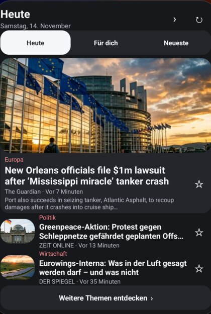

# Android-Nachrichtenwidget

Das Widget zeigt Schlagzeilen aus OpenNews. Tippe auf eine Meldung, um den zugehörigen Artikel im Reader zu öffnen. Über den Namen der Ansicht stellst du für jedes Widget „Heute“, „Für dich“ oder „Neueste“ sowie Thema und Quelle ein. Auf ausreichend großen Widgets wechselt eine Reiterleiste direkt zwischen „Heute“, „Für dich“ und „Neueste“. „Weitere Themen entdecken“ öffnet die Suche und Themenübersicht. Das Sternsymbol speichert die Meldung in OpenNews und öffnet sie. „›“ blättert durch den lokalen Vorrat. „↻“ öffnet OpenNews und stößt die vorhandene Feed-Aktualisierung an. Im schmalsten Layout ist „↻“ bei mehreren Seiten ausgeblendet.

| Platz im Launcher | Darstellung |
| --- | --- |
| Klein, etwa 2 × 2 | Eine Meldung mit Quelle und Zeit |
| Breit, etwa 4 × 2 | Eine Meldung mit mehr Platz für den Titel und eigenen Bedienelementen |
| Größer, etwa 4 × 4 | Themenillustration und bis zu zwei Meldungen |
| Hoch und breit (ab 248 × 340 dp bei Standardschrift) | Datum, Reiterleiste, Bildaufmacher, zwei kompakte Meldungen und Einstieg zu „Entdecken“. Ab 430 dp Höhe erscheint die Kurzbeschreibung, falls vorhanden. |

Android-Launcher (Startbildschirm-Apps) vergeben unterschiedlich viel Platz pro Rasterzelle. Deshalb richten sich die Ansichten nach den verfügbaren Breiten und Höhen in dp. Bei großer Systemschrift sinkt die Anzahl der Zeilen. Text und bedienbare Symbole verwenden helle und dunkle Systemvarianten. Die Darstellung hat keine eigenen Animationen.

## Daten und Aktualisierung

Die Android-App übergibt bis zu 24 bereits gruppierte Meldungen je Reiter an den nativen Widget-Speicher. Die Daten bleiben lokal. Das Widget filtert anschließend nach dem gewählten Thema und der Quelle. Beim Öffnen löst OpenNews die Artikel-ID gegen den lokalen Vorrat auf und lädt bei Bedarf den Volltext im bestehenden Reader. Wenn der ausgewählte Artikel inzwischen aus dem Vorrat gefallen ist, öffnet sich die App. Die Titelliste erhält Aktualisierungen, wenn OpenNews neue Feeds anzeigt. Android kann ungefähr alle 30 Minuten die Darstellung und Zeitangaben auffrischen. Dieser Schritt ruft keine Feeds ab. Ohne Verbindung bleiben die zuletzt gespeicherten Schlagzeilen lesbar. Bei einer leeren Auswahl führt die erste Zeile zur App.

## Vergleich und technische Entscheidung

- Google beschreibt Discover als Vorschlagsfläche für Interessen. OpenNews übernimmt die Idee der schnellen Vorschau. Die Auswahl ist über Ansicht, Thema und Quelle auf dem Gerät einstellbar. [Google Search – Discover](https://developers.google.com/search/docs/appearance/google-discover)
- Google News kombiniert Schlagzeilen, Quellen und unabhängige Perspektiven. OpenNews übernimmt die Schlagzeile mit Quellenangabe und zeigt mehrere Berichte im Hauptfeed. [Google News – Auswahl](https://support.google.com/googlenews/answer/9005749)
- Android stellt Widgets mit `RemoteViews` in einem separaten Launcher-Prozess dar. Die vorhandene Java-Implementierung braucht keine neue Jetpack-Abhängigkeit. Die Plattform stellt die Konfiguration, Größenänderungen und sichere Klickaktionen bereit. [Android Developers – App-Widgets](https://developer.android.com/develop/ui/views/appwidgets)

Das Widget nutzt lokale Themenillustrationen. Die Motive stehen für das Thema. Sie stammen aus dem lokalen Bildbestand der App. Der Google-Discover-Bildschirm eines Launchers lässt sich über diese Android-Schnittstelle nicht austauschen.

## Gerätetest vom 14. November 2026

Eine getrennte Debug-App lief auf einem Samsung-Handy mit Android 17 und One UI. Geprüft wurden das Hinzufügen des 4×2-Widgets, Blättern, direkter Sprung zum angezeigten Artikel mit geladenem Volltext und das Öffnen der Einstellungen. Der Test deckte einen überlagerten Titel im Einstellungsfenster auf. Nach der Korrektur waren Überschrift und Eingaben unterhalb der Statusleiste sichtbar. Die vorhandene OpenNews-Installation blieb erhalten.

### Tagesagenda im 4×5-Format

Am 14. November 2026 lief die GitHub-Test-APK aus PR #111 auf demselben Samsung-Gerät. Im Launcher geprüft wurden das Hinzufügen der großen Variante, die Reiter „Für dich“ und „Neueste“, der Sprung zum passenden Artikel, das Merken mit anschließendem geöffnetem Reader und der Aufruf von „Entdecken“. Die Aktualisieren-Taste holte OpenNews in den Vordergrund. Weitere Launcher, Helligkeitsmodi und Schriftgrößen wurden für diese Variante nicht am Gerät geprüft.

