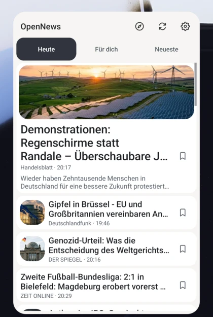

# OpenNews-Feed auf Android

Halte eine freie Stelle auf dem Startbildschirm gedrückt. Öffne **Widgets** und füge **OpenNews-Feed** hinzu. Ziehe anschließend an den Griffen, um die Breite oder Höhe zu ändern. Wische innerhalb der Meldungen nach oben oder unten, um den Feed direkt auf dem Startbildschirm zu lesen.

| Platz im Startbildschirm | Darstellung |
| --- | --- |
| Klein oder schmal | Kompakte Schlagzeilen und Zugang zu den Widget-Einstellungen |
| Mittel | Scrollbare Meldungen mit optionalen Vorschaubildern, Merken-Taste und Feed-Aktualisierung |
| Breit und hoch | Direkte Reiter für **Heute**, **Für dich** und **Neueste**, Einstieg zu **Entdecken** und Platz für einen Aufmacher |

Bei Standardschrift wechselt das Layout ab etwa 188 × 144 dp zur mittleren und ab 264 × 236 dp zur großen Ansicht. Android-Launcher (Startbildschirm-Apps) bestimmen Raster, mögliche Größen und Ausrichtung. Bei größerer Systemschrift brauchen die breiteren Ansichten mehr Platz. Das Widget verwendet auch im kleinsten Format dieselbe scrollbare Liste. [Android-Dokumentation zur Größenwahl](https://developer.android.com/develop/ui/views/appwidgets/layouts)

## Einrichten und lesen

- Tippe auf das Zahnrad oder den Reiternamen oben. **Ansicht**, **Thema** und **Quelle** gelten jeweils für dieses Widget. Die angebotenen Themen und Quellen stammen sowohl aus den zuletzt geladenen Meldungen als auch aus all deinen abonnierten Quellen (alphabetisch sortiert). Du kannst zum Beispiel zwei Widgets für unterschiedliche Quellen anlegen.
- **Automatisch** richtet die Darstellung nach der Größe aus. **Kompakt** zeigt Textzeilen auch auf größeren Widgets. **Magazin** hebt die erste Meldung bereits bei mittlerer Größe hervor.
- Schalte Vorschaubilder, den Kurztext zum Aufmacher oder Quelle und Veröffentlichungszeit einzeln um. Wenn ein Feed ein Artikelbild mitliefert, lädt `WidgetImageCache` es herunterskaliert (max. 360 px) direkt auf das Gerät; ansonsten erscheint automatisch eine lokale Themenillustration.
- Unter **Farbmodus** folgt **OpenNews** der Farbwahl der App. **Hell** und **Dunkel** gelten jeweils für dieses Widget. Die Bedienelemente folgen der App-Sprache, sobald OpenNews einen Feed übergeben hat.
- Tippe auf eine Meldung, um sie im Reader zu öffnen. Die Merken-Taste legt sie in die Leseliste (oder entfernt sie wieder, wenn sie bereits gemerkt war) und öffnet den Reader. Ein gefülltes Symbol zeigt eine bereits gemerkte Meldung.
- Unter **Automatische Aktualisierung** siehst du den Zeitpunkt der letzten Aktualisierung, kannst mit **Jetzt aktualisieren** sofort im Hintergrund neu laden und wählst je Widget den gewünschten Hintergrund-Rhythmus: **Aus (nur manuell)**, **Alle 15 Minuten**, **Alle 30 Minuten** (Standard), **Jede Stunde**, **Alle 2 Stunden** oder **Alle 4 Stunden**.
- **Feed aktualisieren** im Widget-Kopf lädt deine abonnierten Feeds direkt im Hintergrund auf dem Gerät nach, ohne den Startbildschirm zu verlassen, und zeigt ab mittlerer Größe den Zeitstempel der letzten Aktualisierung an (erst wenn noch keine Feeds übergeben wurden, öffnet die Taste die App). **Themen entdecken** springt zur Themenübersicht der App.

## Daten und Aktualisierung

OpenNews übergibt bis zu 24 gruppierte Meldungen je Reiter, ihren Merkstatus, die abonnierten Feed-Adressen (bis zu 25 Nicht-Podcast-Quellen), aktive Stummschalt-Begriffe, die App-Sprache und die Farbwahl an den lokalen Widget-Speicher (`opennews-widget`). Solange für mindestens ein aktives Widget ein Aktualisierungsintervall gewählt ist, plant Android über den systemeigenen `JobScheduler` (`WidgetRefreshService`) einen netzwerkabhängigen Hintergrundabruf im kürzesten gewählten Rhythmus (mindestens 15 Minuten, überlebt Geräteneustarts). Dabei ruft Android die abonnierten RSS-, Atom- und JSON-Feeds direkt vom Gerät aus ab – datensparend mit `ETag`/`If-Modified-Since`-Prüfung –, filtert Werbebeiträge, unsichere Links und deine stummgeschalteten Begriffe heraus und aktualisiert den lokalen Widget-Vorrat, ohne die App zu öffnen; Merkstatus und bestehende Meldungen bleiben erhalten. Stehen alle Widgets auf **Aus (nur manuell)** oder wird das letzte Widget entfernt, wird der Hintergrund-Job beendet. Das Widget wendet die gewählten Filter auf diesen Vorrat an. Bei einem leeren Ergebnis führt die Anzeige je nach Ursache zum Feed-Abruf oder zu den Filtern. Beim Öffnen löst die App die Artikel-ID gegen den lokalen Vorrat auf und lädt bei Bedarf den Volltext. Offline kannst du die zuletzt gespeicherten Schlagzeilen weiter durchscrollen.

Der Feed ist ein Widget für den Startbildschirm. Welche Fläche ein Launcher über die seitliche Wischgeste öffnet, bestimmt der Launcher. [Android-Dokumentation zu scrollbaren Widgets](https://developer.android.com/develop/ui/views/appwidgets/collections)

## Prüfung im Emulator

Im Pixel-Launcher mit Android 16 wurden mit echten Meldungen die Größen 4 × 5 und 2 × 2 geprüft. Im großen Format wurden Scrollen, Reiterwechsel, Hell und Dunkel sowie der Sprung in den Reader geprüft. Im kleinen Format ließen sich die Quellen- und Zeitzeile ausblenden und gespeicherte Meldungen im Flugmodus durchscrollen. Der Launcher-Test deckt Pixel ab. Für Android 7 bis 11 und andere Launcher steht der Gerätetest aus.
