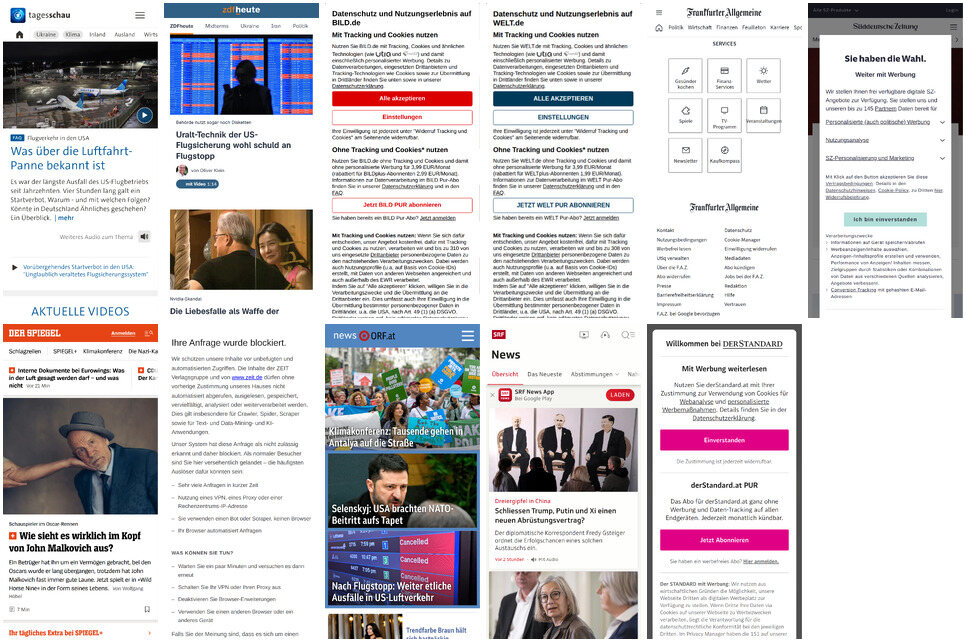
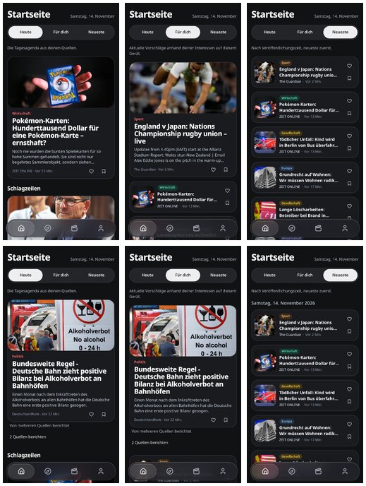

# Mobiler Vergleich für Issue 72

## Stichprobe vom 14. November 2026

Emuliertes Pixel 7 im Browser, 412 CSS-Pixel breit, Deutsch, frische Profile ohne Anmeldung. Erhebung zwischen 18:46 und 18:48 Uhr (Berlin). Die Aufnahmen zeigen den ersten Bildschirm. Ein Zustimmungsdialog oder eine blockierte Seite zählt als Zugangsbeschränkung. Die Untersuchung erfasst öffentliche mobile Webseiten. Die Platzierungslogik der Anbieter ist aus einer Aufnahme nicht ableitbar.

| Angebot | Sichtbarer erster Bildschirm | Schluss für OpenNews |
| --- | --- | --- |
| [Tagesschau](https://www.tagesschau.de/) | Aufmacher zur US-Flugsicherung mit Bild, Einordnung, Audio, anschließend Videos. | Ein Aufmacher mit erkennbarer Bedeutung und kurzen Folgezeilen. |
| [ZDFheute](https://www.zdfheute.de/) | Aufmacher zur US-Flugsicherung, danach ein anderes Thema. Sichtbare Quellenmarke und Videoformat. | Früh verschiedene Geschichten anbieten, auch wenn mehrere Feeds das Hauptthema wiederholen. |
| [DER SPIEGEL](https://www.spiegel.de/) | Schnellzugriff mit Minutentakt und davon getrennte große Interviewkarte. | Tagesagenda und zeitlich sortierte Liste erfüllen unterschiedliche Aufgaben. |
| [ORF](https://orf.at/) | Mehrere gestapelte Bildschlagzeilen, darunter Klima, Außenpolitik und Luftverkehr. | Breite früh sichtbar machen, ohne jede Geschichte als Großkarte darzustellen. |
| [SRF](https://www.srf.ch/news) | „Übersicht“ und „Das Neueste“ als eigene Reiter. Auf der Übersicht außenpolitischer Aufmacher. | Eigener chronologischer Reiter mit Datum und kompakten Zeilen. |
| [BILD](https://www.bild.de/), [WELT](https://www.welt.de/), [SZ](https://www.sueddeutsche.de/), [STANDARD](https://www.derstandard.at/) | Zustimmung oder Abo verdeckten den ersten Bildschirm. | Kein Wert für die Platzierung erhoben. |
| [FAZ](https://www.faz.net/aktuell/), [ZEIT](https://www.zeit.de/) | Bei FAZ war nur die Servicefläche sichtbar. ZEIT blockierte den Zugriff. | Kein Wert für die Platzierung erhoben. |
| [upday](https://www.upday.com/de), [Guardian](https://www.theguardian.com/international), [BBC](https://www.bbc.com/news) | Öffentliche Schlagzeilenmischung abrufbar. Beim Guardian auch Kultur und Hintergrund. Die BBC zeigte früh eine Videozeile. | Format und Themenmix beim Vergleich miterheben. |
| Google News, Apple News, Flipboard, SmartNews, Feedly, Inoreader | Abruf gestört, Einwilligung oder öffentliche Produktseite anstelle einer nutzbaren personalisierten Nachrichtenansicht. | Keine Ableitung über deren persönliche Trefferquote. |
| NYT, Instagram, X, Threads, YouTube | Einstiegsseiten mit Datenschutzdialog, Anmeldung oder leerem Einstieg. | Keine Rangfolge erhoben. |

Die Tagesschau dokumentiert für ihre App eine eigene Ansicht „Für mich“ und einen Meldungsbereich. Das ist ein Herstellerbeleg für die Trennung der Ansichten. Eine eigene Stichprobe aus „Für mich“ steht aus. [Tagesschau im App Store](https://apps.apple.com/de/app/tagesschau-nachrichten/id401644893)

Apple News und Google Discover im nativen Einsatz sowie historische Artifact-Daten wurden nicht gemessen. Auch für freigegebene Webseiten fehlen noch vollständige Top-12-Listen und Zeitangaben. Die Tabelle belegt deshalb keine Überlegenheit gegenüber den Wettbewerbern.

## OpenNews auf demselben Nachrichtenstand

Am 14. November 2026 um 18:47 Uhr (Berlin) lieferte der OpenNews-Server 300 Artikel aus 13 abonnierten Standardquellen ohne Podcasts. 297 Artikel blieben nach der üblichen viertägigen Aufbewahrung übrig. Beide Fassungen verarbeiteten denselben Satz zur gleichen Uhrzeit. Basis war `ad6e6a5`. Für „Für dich“ wurden Technologie und Wissenschaft mit je vier Punkten und heise mit drei Punkten als feste Präferenzen verwendet. Die Browserbilder zeigen zusätzlich ein neues Profil ohne Lernverlauf.

| Ansicht | Quellen | Größte Quelle | Themen | Median Alter | Unter 24 Stunden | Weitere Berichte in Gruppen | Auswahlgründe |
| --- | --- | --- | --- | --- | --- | --- | --- |
| Heute | 9 → 8 | 2/12 → 2/12 | 8 → 8 | 0,6 → 0,6 h | 12 → 12 | 0 → 3 | 0 → 3 |
| Für dich | 9 → 9 | 2/12 → 2/12 | 8 → 8 | 0,4 → 0,5 h | 12 → 12 | 0 → 2 | 4 → 6 |
| Neueste | 4 → 4 | 5/12 → 5/12 | 6 → 6 | 0,4 → 0,4 h | 12 → 12 | 0 → 0 | 0 → 0 |

„Heute“ führte zuvor mit dem Preis einer Pokémon-Karte. Danach stand die Bahn-Meldung zum Alkoholverbot oben, zu der zwei Quellen berichteten. Diese Platzierung zeigt die Wirkung des Quellenbonus. In der Stichprobe sank die Zahl der sichtbaren Quellen um eins. Vier der zwölf Empfehlungen passten in beiden Fassungen zu den voreingestellten Themen. In „Neueste“ gehörten fünf der zwölf jüngsten Beiträge derselben Quelle. Das ergibt sich aus den Veröffentlichungszeiten. Hier hilft die Gruppierung nach Kalendertag beim Überfliegen. Die algorithmische Gruppierung fasst Formulierungsvarianten zusammen, soweit die Regeln greifen. Eine manuelle Dublettenquote wurde noch nicht erhoben.

Ein lokaler Laufzeitvergleich mit jeweils 100 Wiederholungen für den gesamten Auswahlaufruf ergab Medianwerte von rund 8–9 ms vorher und 8 ms nachher. Das misst die Auswahl im Node-Prozess ohne Netz oder Darstellung. Der gespeicherte Datensatz enthält die damals eingelesenen Kategorien. Eine spätere Korrektur der Themenzuordnung wird mit dem nächsten Feed-Abruf wirksam. Weitere Erhebungstage und personalisierte Stichproben der Wettbewerber sind für die Abnahme noch offen.
